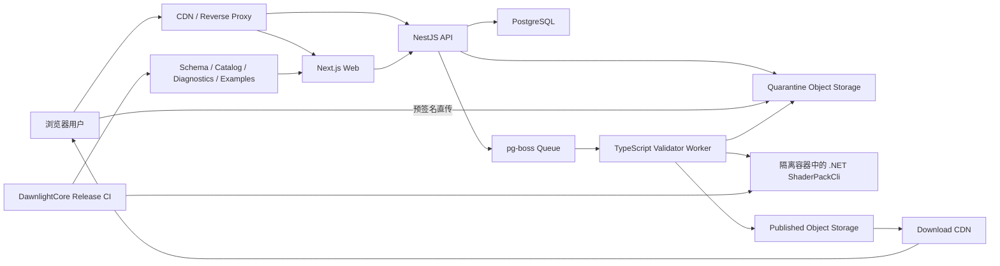

# DawnlightCore 网站整体开发文档

状态：架构与产品基线

编写日期：2026-08-16

适用范围：DawnlightCore 开发者门户、官方下载服务与未来光影社区

## 1. 文档目的

本文定义 DawnlightCore 网站的整体产品、前端、后端、数据、发布、验证、安全和运维方案，作为后续设计、任务拆分、实现和验收的共同基线。

网站定位不是单纯的产品宣传页，而是两个相互关联的产品面：

1. 面向光影开发者的开发者门户，包括版本化文档、规范参考、示例、诊断和开发工具；
2. 面向玩家与作者的光影分发平台，包括官方下载安装、光影发现、版本兼容、上传验证和审核发布。

网站主体前后端均使用 TypeScript。DawnlightCore 的生产 C# Manifest Loader 和 `ShaderPackCli` 继续作为光影包语义验证的唯一权威实现，由隔离的 Validator Worker 调用，不在 TypeScript 中复制渲染图、Catalog、资源 hazard 或设置 UI 的完整验证逻辑。

## 2. 背景与当前能力基线

DawnlightCore 当前已经基本完成：

- P8 光影包数据驱动；
- P9 光影包设置菜单数据驱动；
- Manifest v3 根文档与有序 fragments 组合；
- Graphics、Compute Program 和 option/capability define；
- texture、buffer、history 等资源声明；
- Fullscreen、Compute、Copy、Clear、Present、EngineDraw、HistoryCommit 命令；
- 生产 Loader、严格诊断、canonical hash、generation 发布、回滚与 retirement；
- BuiltIn Minimal 与 External Complete 两类运行时；
- `ShaderPackCli` 对生产 Loader 的复用。

当前系统仍处于公共 ABI 持续演进阶段。网站和社区必须明确展示而不能掩盖以下边界：

- Terrain Provider 等场景接入仍存在固定 target layout 和固定宿主假设；
- Catalog、Semantic、EngineDraw Provider 和 capability 仍需继续公共化；
- 正式 JSON Schema、Catalog introspection、graph dump 和 variant explain 工具仍需补齐；
- 材质、方块、实体和物品的稳定映射 ABI 尚未完全建立；
- Multi-view 和 VR 不能默认视为完整光影管线已支持；
- 网站校验通过不等同于所有 GPU 和驱动上的实机运行通过。

因此，在 clean-room 第三方光影包和公共 ABI 得到充分验证前，社区投稿应先采用维护者录入或邀请制审核，不直接开放无审核发布。

## 3. 产品目标

### 3.1 开发者门户目标

- 让新作者能从空目录开始创建并验证最小光影包；
- 让作者准确理解 JSON、GLSL、可信 C# Catalog 三者的边界；
- 为每个 DawnlightCore 版本提供不可变、可追溯的文档；
- 让 Manifest 字段、Catalog、Semantic、诊断代码和示例可搜索、可深链；
- 保证公开示例经过对应版本的生产 Loader 自动验证；
- 将复杂渲染图以资源和 Pass 图的方式可视化；
- 明确稳定、实验性、已弃用和不支持能力。

### 3.2 下载服务目标

- 按平台、架构、发布渠道和兼容性提供正确安装包；
- 展示文件大小、SHA-256、签名、运行要求和变更记录；
- 支持国内与全球镜像，而不让业务 API 代理大文件；
- 提供机器可读的发布清单，供网站和未来客户端更新功能复用；
- 保证已发布 artifact 不可变，修复必须生成新版本。

### 3.3 光影社区目标

- 支持项目、团队、版本、文件、依赖、兼容性、图库和更新日志；
- 根据用户环境推荐正确版本，而不只是提供“最新下载”；
- 对上传包执行隔离的生产 Loader 验证和安全检查；
- 区分机器验证、人工审核和实机测试；
- 支持审核、举报、撤回和可追溯的管理操作；
- 后续支持收藏、关注、集合和统计，但不让社交功能先于发布安全与兼容性。

## 4. 非目标

首期及社区早期阶段明确不做：

- 不实现 Iris/OptiFine 文件格式兼容；
- 不允许 JSON 注册或执行任意 C#、JavaScript、网络或文件系统代码；
- 不在 TypeScript 中重写完整 Dawnlight Manifest Loader；
- 不在 API 进程内编译或运行不可信 GLSL；
- 不让 Next.js Server Actions 或 Route Handlers 直接承担完整社区后端；
- 不将二进制包保存进 PostgreSQL；
- 不使用 API 服务器中转大文件上传和下载；
- 不在初期引入微服务、Kubernetes、GraphQL、Elasticsearch 或复杂事件平台；
- 不把内部 P8/P9 计划、迁移记录和验收材料原样当作面向作者的公开文档；
- 不在缺少内容政策、许可证规则和审核能力时开放完全公开投稿。

## 5. 用户角色与核心任务

| 角色 | 核心任务 |
|---|---|
| 玩家 | 下载 DawnlightCore，发现光影，判断兼容性，选择正确版本，查看安装说明 |
| 新手作者 | 完成快速开始，下载模板，查询字段，运行 CLI，理解错误并修复 |
| 高级作者 | 查询 Catalog/Semantic，分析资源图和 variant，发布多个兼容版本 |
| 项目成员 | 编辑项目、管理版本、依赖、图库和团队权限 |
| 审核员 | 查看自动验证结果，检查许可证和内容，批准、拒绝或要求修改 |
| 管理员 | 管理用户、项目、审核策略、系统配置和审计记录 |
| 工具/客户端 | 通过稳定 REST API 和发布清单查询版本、兼容性和下载地址 |

所有主要流程应围绕用户任务设计，而不是围绕数据库表或内部服务划分界面。

## 6. 产品与工程原则

1. **规范可追溯**：文档、Schema、Catalog 和 Loader 版本必须能对应到具体 DawnlightCore 发布版本。
2. **生产 Loader 唯一真相**：JSON Schema 负责编辑提示和基础结构校验，最终合法性由生产 Loader 决定。
3. **兼容性结构化**：Core、Manifest、游戏、平台和 GPU 能力分别建模，不把兼容性压缩成自由文本标签。
4. **Artifact 不可变**：发布后的文件由内容 hash 标识，不允许静默覆盖。
5. **不可信内容隔离**：压缩包、GLSL、图片和作者 Markdown 都按不可信输入处理。
6. **静态优先、动态渐进**：文档和官方发布先静态化，社区功能出现后再启用必要的动态服务。
7. **模块化单体优先**：API 和 Worker 保持清晰模块边界，但初期不拆微服务。
8. **Web 不是唯一客户端**：API 合同应可供 CLI、启动器和第三方工具使用。
9. **清晰胜过装饰**：UI 优先可扫描性、对比和稳定布局，不使用影响阅读的视觉噱头。
10. **状态必须可解释**：兼容、验证、审核、发布和错误状态必须给出原因和下一步操作。

## 7. 总体系统架构



### 7.1 服务边界

- `web`：页面渲染、文档、交互和面向用户的 BFF 调用，不直接访问数据库；
- `api`：认证、授权、项目、版本、上传、发布、审核、搜索和公共 REST API；
- `worker`：消费持久化任务、处理压缩包、调度隔离验证、同步搜索索引和聚合统计；
- `validator image`：包含固定版本 `.NET ShaderPackCli` 和可选静态 GLSL 工具；
- PostgreSQL：业务数据、任务、审计和一致性来源；
- Object Storage：隔离上传、已发布文件和项目图片；
- CDN：公开图片、安装包和光影包分发。

## 8. 技术选型

所有依赖采用实现时的稳定版本，通过 lockfile 和 Renovate/Dependabot 管理升级，不在架构文档中绑定不必要的补丁版本。

### 8.1 前端

| 领域 | 选择 | 用途 |
|---|---|---|
| 框架 | Next.js App Router | SSG、SSR、动态社区页面、SEO、路由和服务端组件 |
| 语言 | TypeScript strict | 静态检查和跨端合同 |
| 文档 | Fumadocs + MDX | 文档树、目录、版本化内容、代码高亮和搜索接入 |
| 样式 | Tailwind CSS + CSS Variables | 设计 token 和响应式布局 |
| 无障碍原语 | Radix UI | Dialog、Menu、Tabs、Tooltip、Select 等交互 |
| 组件基础 | shadcn/ui，按需复制 | 保持可控样式，不引入封闭主题系统 |
| 图标 | Lucide | 工具和命令按钮图标 |
| 国际化 | next-intl | UI、路由和文档语言 |
| 数据获取 | TanStack Query | 客户端 mutation、缓存和失效；服务端读取优先使用 Server Component |
| 表格 | TanStack Table | 版本、文件、团队和审核列表 |
| 表单 | React Hook Form + Zod | 前端表单状态和即时验证 |
| 代码高亮 | Shiki | JSON、GLSL、PowerShell、C#、日志 |
| 图可视化 | React Flow + ELK.js | 后期 Pipeline Graph Viewer |
| 测试 | Vitest + Testing Library + Playwright | 单元、组件和端到端测试 |

### 8.2 后端

| 领域 | 选择 | 用途 |
|---|---|---|
| 框架 | NestJS | 模块边界、依赖注入、认证、OpenAPI 和测试结构 |
| HTTP Adapter | Fastify | HTTP 性能、Schema 和低开销请求处理 |
| API | REST + OpenAPI | Web、CLI、启动器和第三方客户端的稳定合同 |
| ORM | Prisma | Schema、迁移、事务和类型安全查询 |
| 数据库 | PostgreSQL | 核心业务数据和全文/模糊搜索初期实现 |
| 后台任务 | pg-boss | 基于 PostgreSQL 的持久任务、重试和去重 |
| 对象存储 | S3-compatible SDK | R2、MinIO、COS 或其他 provider |
| 日志 | Pino | 结构化日志和请求关联 ID |
| 可观测性 | OpenTelemetry | Trace、Metric 和跨服务关联 |
| 测试 | Vitest/Jest + Testcontainers + Supertest | 单元、数据库集成和 API 合同测试 |

初期使用 `pg-boss` 避免为低任务量单独维护 Redis。只有在队列吞吐、限流、短期缓存或实时功能确实需要时，再引入 BullMQ + Redis。

## 9. 推荐仓库结构

```text
dawnlight-core/
├─ apps/
│  ├─ web/                     # Next.js + Fumadocs
│  ├─ api/                     # NestJS REST API
│  └─ worker/                  # TypeScript 后台任务与验证调度
├─ packages/
│  ├─ api-client/              # 从 OpenAPI 生成，不手工维护
│  ├─ database/                # Prisma schema、client 和迁移
│  ├─ ui/                      # 跨 Web 页面复用的领域无关组件
│  ├─ config/                  # ESLint、TypeScript、Vitest 配置
│  └─ shared/                  # 少量纯 TS 值对象和通用常量
├─ content/
│  └─ docs/                    # 公开 MDX 文档
├─ contracts/
│  ├─ openapi/                 # API OpenAPI snapshot
│  └─ dawnlight/               # Core CI 生成的版本化合同快照
├─ infra/
│  ├─ docker/
│  ├─ compose/
│  └─ deployment/
├─ docs/                       # 本项目架构、ADR、计划与运维文档
├─ package.json
├─ pnpm-workspace.yaml
└─ turbo.json
```

使用 pnpm workspace 和 Turborepo 管理构建缓存与任务依赖。`shared` 不得成为任意代码的堆放目录；数据库模型不得直接作为公共 API DTO。

## 10. URL 与信息架构

### 10.1 公开路由

```text
/{locale}
/{locale}/docs/{coreVersion}/...
/{locale}/downloads
/{locale}/releases
/{locale}/releases/{version}
/{locale}/shaders
/{locale}/shaders/{slug}
/{locale}/shaders/{slug}/versions
/{locale}/shaders/{slug}/versions/{versionId}
/{locale}/shaders/{slug}/gallery
/{locale}/tools/diagnostics
/{locale}/tools/catalog
/{locale}/tools/pipeline-graph
/{locale}/status
```

语言前缀始终存在，例如 `/zh-CN` 和 `/en-US`，避免同一内容出现多个 canonical URL。无语言 URL 只做一次重定向。

文档 URL 使用不可变 Core 版本。`latest` 可以作为便捷别名，但应重定向到具体版本，而不是作为搜索引擎 canonical URL。

### 10.2 账户与管理路由

```text
/{locale}/dashboard
/{locale}/dashboard/projects
/{locale}/dashboard/projects/new
/{locale}/dashboard/projects/{projectId}
/{locale}/dashboard/projects/{projectId}/versions/new
/{locale}/dashboard/team
/{locale}/dashboard/settings
/{locale}/moderation
/{locale}/moderation/submissions/{submissionId}
/{locale}/admin
```

### 10.3 全局导航

主导航保持为：

- 文档；
- 光影；
- 下载；
- 工具。

右侧固定提供：

- 全局搜索；
- Core 文档版本；
- 语言；
- Light/Dark/System 主题；
- 用户菜单。

“控制台”仅在登录后显示。管理入口只对有权限的用户显示，但隐藏入口不能替代服务端授权。

## 11. 首页设计

首页承担产品识别和快速分流，不承担完整文档说明。

### 11.1 第一视口

- 使用一张清晰、可检查的真实 Dawnlight 游戏画面作为全宽背景；
- H1 直接使用 `DawnlightCore`；
- 一句话说明其为 Survivalcraft 数据驱动通用光影加载器；
- 主要操作为“下载稳定版”和“开始开发光影”；
- 显示当前稳定版、Manifest 版本、发布日期和主要支持平台；
- 保留下一部分内容在视口底部可见；
- 不把标题或主要体验放进卡片，不使用装饰性渐变或抽象 SVG hero。

### 11.2 后续内容

按顺序展示：

1. 开发者快速入口：快速开始、Manifest、示例包、CLI；
2. 最新稳定版及安全校验信息；
3. 精选或官方光影；
4. 当前能力状态与已知限制；
5. 最新发布记录。

项目尚未开放社区时，“精选光影”只能显示官方或维护者确认的包，不能伪造社区活跃度。

## 12. 开发文档产品设计

### 12.1 文档分类

公开文档至少包含：

```text
快速开始
├─ 环境与工具
├─ 第一个 BuiltIn Minimal 包
├─ 第一个 External Complete 包
└─ 使用 ShaderPackCli 验证

核心概念
├─ JSON、GLSL 与 C# Catalog 边界
├─ Manifest generation 与事务发布
├─ Program、Resource、Pass、Command
├─ 资源访问、hazard 与 history
└─ BuiltIn Minimal 与 External Complete

规范参考
├─ Manifest v3
├─ 组合与 fragments
├─ Program 和 variants
├─ Resources 和 bindings
├─ Passes 和 commands
├─ Semantics 和 Catalog
├─ Options 和 Settings UI
└─ 诊断代码

教程
├─ 最小地形光影
├─ 全屏后处理
├─ Compute Pass
├─ History Resource
├─ 设置页面与翻译
└─ 完整光影包结构

工具与调试
├─ CLI
├─ Catalog Explorer
├─ Pipeline Graph
├─ Variant Explorer
├─ RenderDoc 调试
└─ 常见错误

兼容与迁移
├─ 能力矩阵
├─ 已知限制
├─ 版本迁移
└─ Deprecation Policy
```

### 12.2 文档页面布局

桌面端采用三栏：左侧文档树、中央正文、右侧当前页目录。中央正文不超过适宜阅读宽度；表格和代码块可以在内容区域内横向滚动，但不能导致整页横向溢出。

移动端：

- 左侧树变为可搜索抽屉；
- 当前页目录变为正文顶部折叠区；
- 版本、语言和搜索保持一到两次点击可达；
- 代码块提供独立复制按钮和横向滚动；
- 不用底部固定栏遮挡正文。

### 12.3 文档元数据

每个 MDX 页面使用经过 Schema 校验的 frontmatter：

```yaml
title: Program 定义
description: 定义 Graphics 和 Compute Program 及其 variants
coreVersion: 1.0
manifestVersion: 3
status: stable
lastVerifiedWith: 1.0.0
sourceContract: programs.schema.json
```

允许状态：

- `stable`：公共合同，可按兼容策略依赖；
- `experimental`：可能在小版本调整；
- `deprecated`：仍受支持但有明确迁移目标；
- `internal`：不进入公开构建。

页面顶部必须可见地展示适用版本和状态。实验能力不能仅靠正文备注提示。

### 12.4 参考页标准结构

每个字段或命令参考页应包含：

1. 用途和执行时机；
2. 字段类型、必需性、默认值和限制；
3. 引入、变更和废弃版本；
4. BuiltIn/External 适用范围；
5. 最小合法示例；
6. 完整场景示例；
7. 常见错误和稳定诊断代码；
8. 与其他字段、Catalog 或 capability 的关系；
9. 对资源、Program variant 或 generation 重建的影响；
10. 相关教程和下一步。

### 12.5 代码示例

- JSON、GLSL 和 CLI 示例必须可复制；
- 示例显示来源文件路径和验证版本；
- 完整示例保存在真实 fixture 或 example pack 中，MDX 引用而不是复制两份；
- CI 使用对应版本生产 Loader 验证所有公开 example pack；
- 代码块显示“已由 ShaderPackCli 验证”或“仅示意”；
- 错误示例必须明确标注预期诊断代码；
- 不在浏览器中声称 GLSL 已在所有硬件通过实机验证。

### 12.6 搜索

全局搜索使用 `Ctrl/Cmd + K` 打开，并提供作用域：

- 全部；
- 当前版本文档；
- 所有文档版本；
- 光影项目；
- 诊断代码。

文档搜索结果必须显示 Core 版本和内容状态，避免作者误入旧规范。中文分词和拼音/英文混合搜索需要专门验收，不能仅验证英文词条。

初期使用 Fumadocs/Orama 静态索引。社区搜索规模和筛选维度增加后，将项目数据迁移到 Meilisearch，文档仍可保留独立静态索引或统一聚合展示。

## 13. 在线开发工具

工具是开发者门户的长期差异化能力，但必须复用 Core 生成的数据，不能形成第二套语义实现。

### 13.1 Diagnostic Explorer

- 按代码、关键字和 JSON path 搜索；
- 展示严重级别、含义、常见原因、错误示例和修复示例；
- 深链到对应规范字段；
- 数据由 Core 发布流程导出的 `diagnostics.json` 生成。

### 13.2 Catalog Explorer

- 浏览 Semantic、Capability、Stage Template、Service 和 EngineDraw Provider；
- 显示 ID、版本、类型、适用 scope、必需 binding 和限制；
- 支持按类别和 Core 版本筛选；
- 数据由 `catalog list --json` 或等价工具生成。

### 13.3 Pipeline Graph Viewer

- 读取 `graph dump --json` 的结构化输出；
- 展示 Pass 顺序、命令、Program、resource read/write、history 和 present；
- 点击节点显示来源 JSON 文件和 path；
- 用颜色和图标区分 resource、command、host 和 error；
- 支持只看活动闭包、资源生命周期和 hazard；
- React Flow 负责交互，ELK.js 负责确定性布局；
- 初期只展示官方示例，后期允许上传到隔离服务后生成图。

### 13.4 Variant Explorer

- 选择 option 和 capability；
- 展示最终 define、Program fingerprint 和 invalidation impact；
- 输出必须由 `variant explain --json` 生成；
- 不在前端复制 value map 或 variant 计算算法。

## 14. 光影社区浏览体验

### 14.1 浏览页

默认使用信息密度较高的列表视图，并允许用户切换网格视图。列表适合比较兼容性和更新时间，网格适合观察视觉效果。

主要筛选：

- DawnlightCore 版本；
- Survivalcraft/API 版本；
- Manifest 版本；
- Windows、Android、Linux 等平台；
- 最低图形能力；
- Graphics/Compute 等 feature requirement；
- 稳定、Beta、Alpha 或实验性渠道；
- 性能档位；
- 更新时间、相关度和下载量。

筛选、排序、分页和视图模式写入 URL。浏览器返回、刷新和分享链接后必须恢复状态。

项目列表项只包含：

- 项目图标或实际截图；
- 名称和一句话摘要；
- 作者；
- 最新兼容版本；
- 验证状态；
- 更新时间；
- 经过聚合和去机器人的下载量。

不使用几十个无层次标签填满条目。关键兼容信息必须使用固定字段和一致位置。

### 14.2 项目页

页面结构：

```text
项目图标、名称、摘要、作者、状态
兼容性摘要                         推荐下载
概览 | 版本 | 图库 | 依赖 | 更新日志
```

首屏必须让玩家回答：

1. 这是什么光影；
2. 实际画面是什么；
3. 是否适合我的环境；
4. 应该下载哪个文件；
5. 是否经过验证。

项目页使用真实、未经误导性裁切的游戏截图。图库可以包含原版/光影对比，但必须标注版本、场景和关键设置。

### 14.3 兼容性状态

统一使用以下结果：

- `confirmed`：明确匹配并有相应验证或测试；
- `compatible`：结构化规则判断兼容；
- `unknown`：缺少足够数据；
- `incompatible`：存在确定冲突；
- `unsupported`：目标环境不在作者支持范围。

状态必须同时显示图标和文字，不能仅依赖颜色。悬停或展开后显示判断依据。

### 14.4 验证状态

不得用单个“已验证”徽章混合不同保证。至少拆分为：

- Package Safety：压缩包和文件安全检查；
- Loader Validation：生产 Loader 验证；
- Shader Static Check：静态 GLSL 检查；
- Manual Review：人工审核；
- Hardware Tested：指定平台和 GPU 的实机测试。

每项显示时间、工具版本和范围。Loader Validation 成功不能暗示所有驱动下不会发生编译或渲染问题。

### 14.5 版本页

版本页必须展示：

- display version 和发布渠道；
- 发布时间、作者和 changelog；
- Core、Manifest、游戏和平台兼容范围；
- capability requirements；
- 依赖和冲突；
- artifact 文件名、大小、SHA-256 和签名；
- 完整自动验证报告；
- 撤回、替代或安全警告状态；
- 可复现的下载 URL 或镜像选择。

## 15. 作者后台与发布流程

### 15.1 项目管理

Dashboard 以紧凑列表呈现项目、草稿、审核状态、最新版本和待处理问题。不要使用大量嵌套卡片。

项目编辑分为：

- 基本信息；
- 团队与权限；
- 许可证和来源；
- 图库；
- 发布版本；
- 审核记录；
- 危险操作。

### 15.2 版本发布向导

发布过程拆分为稳定步骤：

1. 版本名称、渠道和 changelog；
2. Core、Manifest、游戏、平台和 GPU 能力；
3. 依赖和冲突；
4. 获取预签名地址并直传隔离存储；
5. 自动验证；
6. 查看错误并重新上传；
7. 预览公开页面；
8. 提交审核或发布。

草稿自动保存。用户离开页面再返回时恢复当前步骤。重复点击提交必须通过 idempotency key 保证不会创建多个版本。

### 15.3 诊断展示

验证错误以文件和 JSON Path 分组：

```text
manifest/ui/settings.json
$.pages[1].groups[0].controls[3]
P9UI203: condition dependency cycle
```

每条错误提供：

- 稳定诊断代码；
- 原始 Loader message；
- 文件和 path；
- 对应文档链接；
- 可操作的修复建议；
- 工具和 Loader 版本。

前端不得通过匹配自然语言错误文本推断错误类型。

## 16. 视觉设计系统

### 16.1 视觉方向

视觉主题使用“精确的开发工具 + 真实的 Dawnlight 画面”。界面主体保持中性，晨光金/琥珀色只作为品牌和主要操作强调色。

避免：

- 大面积紫蓝渐变；
- 深蓝/蓝灰一色到底；
- 玻璃拟态和发光边框；
- 装饰性光球、bokeh 或星空；
- 每个 section 都做成悬浮卡片；
- 卡片内部继续嵌套卡片；
- 用超大标题占据工具或后台页面；
- 通过负 letter-spacing 或 viewport 字号压缩标题。

### 16.2 颜色 token

使用语义 token，而不是在组件中直接写颜色：

```text
background
surface
surface-subtle
foreground
foreground-muted
border
border-strong
brand
brand-foreground
info
success
warning
danger
focus-ring
code-background
```

浅色主题使用接近白色的中性灰背景和白色内容表面；深色主题使用中性炭黑，不使用明显蓝色偏移。状态色分别使用青/蓝、绿、橙和红，不能将品牌色复用于所有状态。

所有文本和交互元素达到 WCAG 2.2 AA 对比度。颜色不是状态的唯一载体。

### 16.3 字体

- 拉丁字符可使用自托管 Inter；
- 中文优先使用系统字体栈，避免首屏下载巨大 CJK Web Font；
- 代码使用 JetBrains Mono 或可靠等宽字体；
- 字号使用离散 token，不随 viewport 宽度连续缩放；
- 正文默认约 16px，文档行高约 1.7；
- 普通页面 H1 控制在约 32-40px，后台和紧凑面板使用更小标题；
- letter spacing 保持 `0`。

### 16.4 尺寸和布局

- 内容和工具采用稳定 max-width；
- 文档正文约 `72ch`，宽表格和图可突破正文但不突破页面；
- 按钮、图标按钮、筛选控件和状态徽章使用稳定高度；
- 卡片圆角不超过 8px；
- 页面 section 使用无框布局或全宽 band；
- 卡片只用于重复项目、弹窗和真正需要边界的工具；
- 所有固定格式的列表、图标按钮和筛选条定义稳定尺寸，加载或 hover 不引发布局位移。

### 16.5 图像

- 首页和项目页使用实际游戏画面；
- 上传图片保留原图，并生成固定规格的 AVIF/WebP 衍生图；
- 列表图、封面和图库声明稳定 aspect-ratio；
- 不用低对比、重度模糊或无法辨认实际效果的图片作为主图；
- 图片展示版本、场景和必要设置，避免误导；
- 用户图片必须经过 MIME sniff、解码重编码、尺寸和像素总量限制。

## 17. 领域 UI 组件

优先建设可跨文档、下载和社区复用的领域组件：

| 组件 | 责任 |
|---|---|
| `CoreVersionSelector` | 选择文档或兼容性 Core 版本 |
| `CompatibilityBadge` | 展示兼容状态及解释 |
| `ManifestVersionBadge` | 展示 Manifest 版本和状态 |
| `CapabilityMatrix` | 比较平台和功能支持 |
| `ValidationSummary` | 汇总机器验证、人工审核和实机测试 |
| `ValidationReport` | 按文件/path 展示诊断 |
| `DiagnosticCodeLink` | 链接到稳定诊断参考 |
| `ManifestFieldTable` | 展示字段类型、约束和版本 |
| `VerifiedCodeBlock` | 展示代码、来源与验证版本 |
| `ArtifactDownloadButton` | 选择兼容 artifact 和镜像 |
| `ShaderProjectRow` | 社区列表中的稳定项目行 |
| `VersionCompatibilityPanel` | 展示版本兼容轴和判断依据 |
| `PipelineGraph` | 展示命令图和资源依赖 |

领域组件不能依赖具体页面 URL，应通过明确 props 和生成的 API Client 获取数据。

## 18. 响应式与无障碍要求

### 18.1 响应式断点原则

- Mobile：单列，筛选和文档树进入抽屉；
- Tablet：正文保持主列，辅助信息按需折叠；
- Desktop：文档三栏、社区侧栏筛选和项目主辅列；
- Wide Desktop：只增加留白或辅助栏宽度，不无限拉长正文。

必须在至少 360px、390px、768px、1280px 和 1536px 视口进行 Playwright 截图检查。

### 18.2 无障碍

- 所有操作可通过键盘完成；
- 使用可见 focus ring；
- Dialog、Menu、Tabs 和 Tooltip 使用成熟无障碍原语；
- 图标按钮必须有可访问名称和 Tooltip；
- 状态使用图标、文本和颜色共同表达；
- 尊重 `prefers-reduced-motion`；
- Pipeline Graph 提供可访问的表格/树替代视图；
- 表单错误与字段通过 `aria-describedby` 关联；
- 动态验证状态通过适当 live region 通知，但避免重复播报。

## 19. 性能目标

### 19.1 Web 性能预算

- 文档和公开项目页尽量服务端渲染或静态生成；
- 首页关键图像明确尺寸、优先级和响应式 source；
- Monaco、React Flow 和 ELK.js 只在对应工具页延迟加载；
- 社区列表不默认加载完整图库和 changelog；
- 禁止将大型 Catalog 或所有文档版本一次性发送给浏览器；
- 避免无意义全局状态和高频客户端重渲染；
- Core Web Vitals 以真实用户数据为准，初期目标为 LCP 小于 2.5s、CLS 小于 0.1、INP 小于 200ms 的良好区间。

### 19.2 API 性能原则

- 公共列表使用 cursor pagination；
- 稳定公开资源使用 ETag/Last-Modified 和 CDN cache；
- 下载计数异步记录和聚合，不同步更新热点项目行；
- 数据库查询显式选择字段，避免 ORM 隐式 N+1；
- 慢查询纳入日志和监控；
- 图片和包文件从对象存储/CDN 返回，API 只返回元数据或重定向。

## 20. API 设计

### 20.1 API 边界

- 公共 API 使用 `/api/v1`；
- Next.js 不直接访问 PostgreSQL；
- Web 使用 OpenAPI 生成的 TypeScript Client；
- Prisma model 不直接作为 DTO；
- API 变更通过 OpenAPI diff 检查；
- 破坏性合同变更进入新 API major 或经过明确弃用期。

### 20.2 典型端点

```text
GET    /api/v1/releases
GET    /api/v1/releases/latest
GET    /api/v1/projects
GET    /api/v1/projects/{slug}
GET    /api/v1/projects/{slug}/versions
GET    /api/v1/versions/{versionId}
GET    /api/v1/versions/{versionId}/validation
POST   /api/v1/projects
PATCH  /api/v1/projects/{projectId}
POST   /api/v1/projects/{projectId}/versions
POST   /api/v1/uploads
POST   /api/v1/uploads/{uploadId}/complete
POST   /api/v1/versions/{versionId}/submit
POST   /api/v1/moderation/submissions/{id}/approve
POST   /api/v1/moderation/submissions/{id}/reject
```

### 20.3 错误格式

API 错误使用稳定 envelope：

```json
{
  "code": "VERSION_NOT_COMPATIBLE",
  "message": "The selected artifact does not support this Core version.",
  "traceId": "...",
  "details": {
    "requestedCoreVersion": "...",
    "supportedRange": "..."
  }
}
```

`code` 面向程序稳定，`message` 面向用户并可本地化。内部异常栈、数据库错误和对象存储凭据不得返回客户端。

### 20.4 幂等与并发

- 创建上传、完成上传、提交审核和发布版本支持 `Idempotency-Key`；
- 编辑项目使用版本号或 `updatedAt` 做 optimistic concurrency；
- 发布操作在数据库事务内锁定草稿并写入 outbox/queue；
- Worker 任务按 upload/version ID 去重；
- 重试不能重复发布 artifact 或重复增加下载统计。

## 21. 后端模块

NestJS 模块按领域而不是按技术层拆分：

| 模块 | 责任 |
|---|---|
| `AuthModule` | OIDC 登录、Session、PAT 和 CSRF |
| `UserModule` | 用户资料、封禁和偏好 |
| `ProjectModule` | 项目、slug、团队和权限 |
| `VersionModule` | 版本、兼容性、依赖、changelog |
| `UploadModule` | 预签名上传、隔离对象和完成确认 |
| `ValidationModule` | 验证任务、结果和重新验证 |
| `ReleaseModule` | DawnlightCore 官方发布和 release feed |
| `SearchModule` | 索引投影、查询和 facet |
| `ModerationModule` | 投稿审核、举报、撤回和决定 |
| `DownloadModule` | artifact 选择、镜像、事件和聚合 |
| `AuditModule` | 管理和安全敏感操作审计 |
| `AdminModule` | 系统管理入口，不承载业务规则 |

模块之间通过显式 service API 和数据库事务协调。不得通过导入其他模块的内部 repository 绕过业务规则。

## 22. 认证与授权

### 22.1 认证

- 不自行实现密码存储；
- 使用 OIDC/OAuth，第一阶段接入 GitHub，按用户需求增加 Gitee 等提供方；
- Web 与 API 通过同源反向代理暴露，例如 `www.example.com/api`；
- 浏览器使用 Secure、HttpOnly、SameSite Cookie；
- 所有状态变更请求启用 CSRF 防护；
- CLI/第三方工具后续使用有 scope、可撤销、只显示一次的 Personal Access Token；
- 登录提供方 ID 与内部用户 ID 分离，允许一个用户绑定多个 provider。

### 22.2 角色

基础角色：

- `user`：管理本人资料、收藏和举报；
- `author`：创建项目；
- `reviewer`：审核投稿和处理一般举报；
- `admin`：系统配置、封禁和高风险操作。

项目内权限独立建模：

- owner；
- maintainer；
- uploader；
- viewer。

每个写操作必须在 API 服务端做资源级授权。前端隐藏按钮只是体验优化。

## 23. 核心数据模型

### 23.1 主要实体

| 实体 | 关键字段和约束 |
|---|---|
| `User` | id、displayName、status、createdAt |
| `ExternalIdentity` | provider、providerSubject，联合唯一 |
| `Project` | id、slug 唯一、name、summary、description、license、status |
| `ProjectMember` | projectId、userId、role，联合唯一 |
| `ProjectVersion` | projectId、displayVersion、channel、status、publishedAt |
| `CompatibilityTarget` | versionId、Core/Manifest/game/platform/capability 结构化范围 |
| `Dependency` | versionId、targetProject、targetVersionRange、kind |
| `Artifact` | versionId、objectKey、fileName、size、sha256、signature、immutable |
| `Upload` | owner、quarantineKey、size、sha256、state、expiresAt |
| `ValidationRun` | upload/version、loaderVersion、status、startedAt、completedAt |
| `ValidationDiagnostic` | runId、code、severity、source、jsonPath、message |
| `Submission` | versionId、status、submittedAt、decisionAt |
| `ModerationDecision` | reviewer、action、reason、createdAt |
| `Report` | reporter、target、category、status |
| `DownloadEvent` | artifact、timestamp bucket、country/edge 等最小化数据 |
| `AuditEvent` | actor、action、target、traceId、metadata、createdAt |

内部主键使用 UUID。用户可见 URL 使用经过保留字和冲突检查的 slug。版本 `displayVersion` 初期保留作者原始格式，不在没有正式版本规范时强制要求 SemVer；兼容范围使用独立、规范化字段。

### 23.2 状态机

版本/投稿建议状态：

```text
DRAFT
  -> UPLOADING
  -> QUEUED
  -> VALIDATING
  -> NEEDS_CHANGES | NEEDS_REVIEW
  -> APPROVED
  -> PUBLISHED
  -> WITHDRAWN | ARCHIVED
```

安全拒绝、作者撤回和管理员归档是不同状态，不得通过删除记录表达。状态转换由领域服务集中校验。

## 24. 兼容性模型

兼容性必须分轴存储和解释：

1. DawnlightCore 版本或公共 ABI 版本；
2. Manifest version；
3. Settings UI schema version；
4. Survivalcraft/API 版本；
5. 操作系统和 CPU 架构；
6. Graphics API 和最低版本；
7. capability/feature requirement，例如 Compute；
8. 明确依赖、冲突和可选增强包；
9. 作者声明、机器验证和实机测试范围。

不得仅保存 `works-on-windows` 一类自由标签，也不得把“Loader 可解析”提升为“硬件确认兼容”。

### 24.1 Artifact 推荐算法

推荐顺序：

1. 排除确定不兼容目标；
2. 优先匹配用户指定平台和架构；
3. 匹配 Core、Manifest 和游戏版本；
4. 校验 capability requirement；
5. 在同一兼容程度下优先 stable，其次 beta/alpha；
6. 多个 artifact 同等时显示选择原因，而不是静默随机选择。

用户可以在本地保存环境偏好，但推荐结果必须允许展开查看和手动覆盖。

## 25. 上传与验证流水线

### 25.1 上传

1. API 创建 `Upload`，检查用户权限、配额和预期文件信息；
2. API 返回短时效预签名 URL、object key 和允许大小；
3. 浏览器直接上传到 quarantine bucket/prefix；
4. 浏览器调用 complete，API 通过对象存储 HEAD 校验存在性和大小；
5. API 事务性地将 Upload 置为 queued 并创建持久任务；
6. 未完成上传按过期时间自动回收。

不要相信浏览器上报的 MIME、大小和 SHA-256；Worker 必须重新计算。

### 25.2 预检

Worker 在调用 Loader 前完成：

- 文件头和实际压缩格式识别；
- 压缩包文件数量、单文件大小和总展开大小限制；
- 压缩比和嵌套压缩包限制；
- 绝对路径、`..`、空段、非法 Unicode 正规化和重复规范化路径检查；
- symlink、hardlink、reparse point 和特殊设备文件拒绝；
- 文件扩展名 allow-list 和实际内容检查；
- 可执行文件、脚本和不允许的二进制拒绝；
- 图片尺寸、像素总量、解码和重编码；
- 恶意软件扫描；
- SHA-256 计算。

### 25.3 生产 Loader 验证

Node Worker 使用 `child_process.spawn` 或容器运行时调用固定版本 `ShaderPackCli`：

- `shell: false`；
- 参数使用独立数组，不拼接命令字符串；
- 容器无网络；
- 非 root 用户；
- 只读 root filesystem；
- 输入目录只读；
- 输出目录独立、大小受限；
- 限制 CPU、内存、进程数和执行时间；
- 不挂载 API 密钥、数据库或生产对象存储凭据；
- 只返回结构化 JSON 和稳定退出码。

CLI 输出建议包含：

```json
{
  "valid": false,
  "loaderVersion": "...",
  "manifestVersion": 3,
  "manifestSha256": "...",
  "settingsSha256": "...",
  "diagnostics": [
    {
      "code": "P9UI203",
      "severity": "error",
      "source": "manifest/ui/settings.json",
      "path": "$.pages[1].groups[0].controls[3]",
      "message": "..."
    }
  ]
}
```

网站不得依赖自然语言 message 分类错误。`code`、`source` 和 `path` 是稳定机器接口。

### 25.4 GLSL 与实机边界

可选静态 GLSL 检查使用成熟工具并记录目标 profile，但结果只代表静态检查。没有 GPU 的服务端验证不能证明：

- 所有厂商驱动编译成功；
- 所有硬件 capability 满足；
- 无 GPU hang、极端性能问题或视觉错误；
- 游戏运行时所有场景均正确。

网站必须将 Loader Validation、Shader Static Check 和 Hardware Tested 分开展示。

### 25.5 发布

验证通过且审核批准后：

1. 在事务中冻结版本元数据；
2. 将 quarantine 对象复制到 content-addressed published key；
3. 再次校验 size 和 SHA-256；
4. 创建不可变 Artifact；
5. 写入发布和索引任务；
6. 成功后清理 quarantine 对象；
7. 失败时保留可重试状态，不产生半发布版本。

## 26. 官方发布与下载服务

### 26.1 第一阶段无数据库发布

文档/下载 MVP 可以只依赖 CI 生成的签名 `releases.json`：

```json
{
  "schemaVersion": 1,
  "channel": "stable",
  "generatedAt": "2026-08-16T00:00:00Z",
  "releases": [
    {
      "version": "...",
      "coreApiVersion": "...",
      "manifestVersions": [3],
      "publishedAt": "...",
      "artifacts": [
        {
          "platform": "windows",
          "architecture": "x64",
          "graphicsRequirement": "...",
          "fileName": "...",
          "size": 0,
          "sha256": "...",
          "url": "...",
          "mirrors": []
        }
      ]
    }
  ]
}
```

实际 Schema 应在实现前单独评审并版本化。发布清单签名与 artifact hash 分离；站点构建失败不能影响已发布文件继续下载。

### 26.2 文件分发

- API 只选择 artifact、记录事件或返回 302，不转发文件内容；
- 全球可优先使用 R2/S3 类存储与 CDN；
- 大陆用户需要稳定体验时，增加 COS/OSS 镜像和合规部署；
- 镜像同步以 SHA-256 验证；
- 镜像异常时回退并显示来源，不静默返回不同内容；
- 对公开不可变 artifact 使用长缓存和内容 hash；
- 安全撤回通过元数据和 CDN 封禁实现，不复用原 URL 发布其他内容。

### 26.3 下载统计

- 不同步递增项目表中的单一热点计数；
- 通过 CDN 日志或轻量事件异步聚合；
- 去除明显机器人、重复探测和镜像同步请求；
- UI 标注统计口径；
- 不将 IP 长期保存为下载统计主键；
- 后期规模足够时再评估 ClickHouse 等分析存储。

## 27. 文档与 DawnlightCore 源仓库集成

### 27.1 来源边界

DawnlightCore 源仓库拥有：

- C# Loader 和运行时行为；
- Manifest/Settings JSON Schema 的生成源；
- Catalog、Semantic、Capability 和诊断代码快照；
- `ShaderPackCli`；
- 生产 example pack 和验证 fixtures；
- 每个发布版本的 machine-readable developer contract。

网站仓库拥有：

- 面向用户的 MDX 教程、概念说明和导航；
- 页面 UI 和工具展示；
- 对版本化 Core contract 的引用；
- 网站 API、社区业务和发布元数据。

### 27.2 Developer Contract Artifact

建议 Core 发布 CI 生成：

```text
dawnlight-developer-contract-{version}.zip
├─ schemas/
│  ├─ shaderpack.schema.json
│  └─ settings-ui.schema.json
├─ catalogs/
│  ├─ semantics.json
│  ├─ capabilities.json
│  ├─ engine-draw-providers.json
│  └─ formats.json
├─ diagnostics/
│  └─ diagnostics.json
├─ examples/
│  ├─ minimal/
│  ├─ fullscreen/
│  └─ complete/
└─ metadata.json
```

网站构建固定引用具体版本和 SHA-256。不能在构建时无条件抓取某个可变分支的最新文件。

### 27.3 防止文档漂移

CI 应检查：

- MDX frontmatter 和内部链接；
- 引用字段在对应 Schema 中存在；
- 引用诊断代码在快照中存在；
- example pack 通过相应版本 CLI；
- 代码片段与真实示例文件同步；
- 文档版本与 contract metadata 匹配；
- 已废弃字段是否有迁移链接。

## 28. 搜索设计

### 28.1 文档搜索

索引字段：标题、描述、正文标题、字段 ID、Program/Resource/Command ID、诊断代码、别名和版本。

结果排序优先级：

1. 完整诊断代码或字段 ID 匹配；
2. 当前版本标题匹配；
3. 当前版本正文匹配；
4. 旧版本内容。

### 28.2 社区搜索

初期 PostgreSQL 使用规范化文本、`pg_trgm` 和明确筛选字段。项目量和多语言检索需求增加后使用 Meilisearch，并由 outbox/Worker 建立最终一致索引。

搜索引擎不是数据真相来源。删除、撤回和权限检查必须以 PostgreSQL 为准；公开结果返回前仍校验项目状态。

Facet 至少包括 Core、Manifest、游戏、平台、capability、渠道和更新时间。中文搜索需验证分词、拼音和中英文混排的实际效果。

## 29. 安全设计

### 29.1 Web 和 API

- 全站 HTTPS 和 HSTS；
- 严格 CSP，逐步消除 `unsafe-inline`；
- Cookie 使用 Secure、HttpOnly、SameSite；
- CSRF、登录尝试和敏感端点限流；
- 所有数据库访问参数化；
- 所有写操作服务端授权；
- 项目 Markdown 使用受限语法并经过服务器端 sanitize；
- 禁止作者内容注入任意 HTML、iframe、script 和远程可执行内容；
- 外部图片优先代理、重编码或严格 allow-list，防止跟踪和 SSRF；
- API 返回统一错误，不泄漏栈和内部路径；
- 管理操作写入不可变审计记录。

### 29.2 上传安全

- quarantine 与 published 使用不同 bucket 或不同凭据边界；
- 浏览器只有单对象、短时效、限制大小的上传权限；
- API 不信任扩展名、MIME、hash 或客户端验证结果；
- Worker 不可访问生产数据库写权限，结果通过受限通道提交；
- 验证容器无网络、非 root、只读、资源受限；
- 禁止服务端执行包内 JavaScript、C#、本地二进制和任意 shader runtime；
- 定期升级解压、图片和恶意软件扫描依赖；
- 对相同内容 hash 复用安全扫描结果时必须包含扫描器和策略版本。

### 29.3 内容与法律

公开投稿前必须定义：

- 可接受内容政策；
- 许可证字段和允许值；
- 第三方资产来源声明；
- 举报、侵权和下架流程；
- 未经授权移植其他游戏光影的处理规则；
- 隐私政策、服务条款和数据保留策略；
- 审核员操作和申诉流程。

## 30. 可观测性与审计

### 30.1 日志

使用 Pino 输出结构化 JSON，字段至少包括：

- timestamp；
- level；
- service；
- environment；
- traceId/requestId；
- userId 的内部不可逆引用；
- route/jobName；
- duration；
- result/errorCode。

日志不得包含 Cookie、Token、对象存储签名 URL、完整 IP、私密项目内容或上传包正文。

### 30.2 Metric

至少监控：

- API 请求量、错误率和延迟；
- 数据库连接池和慢查询；
- queue depth、等待时间、重试和 dead-letter；
- 验证成功率、超时和诊断代码分布；
- 对象存储错误和镜像同步延迟；
- 发布成功率；
- Web Core Vitals；
- 登录和限流异常。

### 30.3 Trace 与审计

OpenTelemetry 贯穿 Web、API、queue 和 Worker。验证任务保留 upload/version ID 和 trace ID。

审计事件至少覆盖：权限变更、项目转移、发布、撤回、审核决定、封禁、PAT 创建/撤销和系统策略修改。

## 31. 部署方案

### 31.1 环境

- Local：Docker Compose 启动 PostgreSQL、MinIO 和必要服务；
- Preview：每个 PR 可选部署 Web，使用隔离或只读 API；
- Staging：与生产拓扑一致，使用独立数据库和 bucket；
- Production：Web、API、Worker、数据库和存储分别部署。

任何环境都不得共享生产密钥。Staging 上传文件不能进入生产 published bucket。

### 31.2 部署单元

- Web：Next.js Node runtime 或适配的 edge/static 部署；
- API：独立 Node.js 容器；
- Worker：独立 Node.js 容器，可水平扩展；
- Validator：由 Worker 启动的受限容器或隔离任务；
- PostgreSQL：优先托管服务，启用 PITR；
- Object Storage/CDN：生产 provider；
- Meilisearch：社区搜索需要后再部署。

### 31.3 中国大陆与全球访问

- 网站构建保持云厂商可迁移；
- 域名、备案和 CDN 选择在上线大陆节点前完成合规评估；
- 避免依赖 Google Fonts 等大陆不稳定外部资源；
- 关键前端依赖、自托管字体和静态资产走自己的 CDN；
- 下载 metadata 提供多个镜像，但同一 artifact 必须 hash 一致；
- GitHub/Gitee Release 可作为发布源或备份，不作为唯一长期分发架构。

### 31.4 数据保护

- PostgreSQL 自动备份和时间点恢复；
- 定期执行恢复演练；
- Prisma migration 在部署前备份并在 staging 验证；
- 不执行自动破坏性 Schema 变更；
- published artifact 采用版本和 retention policy；
- quarantine 自动过期；
- 密钥使用部署平台 secret manager，不进入仓库或日志。

## 32. CI/CD

### 32.1 Pull Request Pipeline

```text
format/lint
-> TypeScript typecheck
-> unit tests
-> database integration tests
-> API contract tests
-> OpenAPI generation and diff
-> MDX/link/frontmatter validation
-> example/contract validation
-> Next.js production build
-> Playwright critical flows
-> dependency and container security scan
```

生成文件必须通过 CI 检查是否与源一致。OpenAPI Client、Prisma Client 和文档索引不得依赖开发者手工更新而不验证。

### 32.2 部署 Pipeline

1. 构建带 immutable tag 的 Web/API/Worker image；
2. 运行迁移兼容检查；
3. 部署 staging 并运行 smoke test；
4. 人工或策略批准生产；
5. 先部署向后兼容数据库迁移；
6. 滚动部署 API/Worker；
7. 部署 Web；
8. 验证 API、登录、下载和 queue；
9. 记录部署版本和回滚目标。

## 33. 测试策略

### 33.1 单元测试

- 兼容性判断；
- artifact 推荐；
- 状态转换；
- 权限矩阵；
- release feed 解析；
- 诊断结果映射；
- UI formatter 和纯组件状态。

### 33.2 集成测试

- Prisma + PostgreSQL 真实容器；
- pg-boss 任务创建、重试和去重；
- MinIO 预签名上传与对象迁移；
- OIDC callback 使用测试 provider；
- Validator 使用固定 fixture 和模拟隔离执行器；
- 事务失败后不产生半发布状态。

### 33.3 合同测试

- OpenAPI snapshot；
- API Client 与 API build 一致；
- Core developer contract Schema；
- `ShaderPackCli --json` 输出 Schema；
- releases feed Schema；
- 旧前端 Client 对兼容 API 的回归。

### 33.4 端到端测试

Playwright 覆盖：

- 文档搜索、版本和语言切换；
- 下载正确 artifact 和镜像；
- 社区筛选 URL 状态；
- 登录和项目创建；
- 预签名上传；
- 验证失败和诊断展示；
- 审核通过并发布；
- 无权限访问；
- 撤回版本后的公开状态。

### 33.5 视觉测试

- Light/Dark/System；
- 中文和英文长文本；
- 360、390、768、1280、1536px；
- 首页、文档、项目页、上传、验证报告和审核页；
- 检查文本截断、重叠、布局位移、图片空白和对比度；
- Pipeline Graph 除截图外检查节点数量和非空画布像素。

### 33.6 安全与负载测试

- ZIP traversal、zip bomb、symlink 和 Unicode path fixture；
- 超大 JSON、深层嵌套、重复字段和未知字段；
- 图片解码攻击和超大像素；
- CSRF、XSS、权限越权和预签名 URL 滥用；
- 上传、搜索和下载跳转限流；
- queue backlog、Validator 超时和对象存储故障；
- 热门项目列表和下载事件聚合负载。

## 34. 分阶段实施计划

### 阶段 0：公共合同准备

范围：

- 明确 DawnlightCore、公共 ABI、Manifest、Settings UI 和游戏版本轴；
- 定义官方 package 格式和安全限制；
- 生成正式 JSON Schema；
- 为 CLI 增加结构化 JSON 输出；
- 规划 `manifest validate`、`catalog list`、`graph dump`、`variant explain`；
- 生成 developer contract artifact；
- 定义 `releases.json` Schema 和签名方式。

退出标准：网站无需读取 C# 源码即可获得一个版本的 Schema、Catalog、诊断和示例，但最终验证仍由 CLI 完成。

### 阶段 1：开发者门户与官方下载 MVP

范围：

- 建立 monorepo、设计 token 和基础组件；
- 首页；
- Fumadocs 文档三栏布局；
- 中文文档和版本路由；
- 全局文档搜索；
- 下载页、发布页和 release feed；
- SHA-256、运行要求和镜像显示；
- CI 文档/示例验证；
- 基础监控和错误页面。

不包含账户、数据库和公开投稿。

退出标准：新作者能从首页进入快速开始，下载模板，依据文档修改，并用 CLI 得到可定位的验证结果；玩家能选择正确官方安装包。

### 阶段 2：开发工具

范围：

- Diagnostic Explorer；
- Catalog Explorer；
- Capability Matrix；
- 官方示例 Pipeline Graph；
- Variant Explorer；
- 文档内容版本 diff 和迁移页面。

退出标准：常用 Catalog 和诊断查询不要求作者阅读内部 C#，图和 variant 结果来自 Core 结构化输出。

### 阶段 3：维护者录入的光影目录

范围：

- NestJS API、PostgreSQL 和对象存储；
- 只读项目、版本、artifact 和兼容性 API；
- 社区浏览、项目页、版本页和搜索；
- 维护者后台录入官方/确认项目；
- CDN 下载和异步统计；
- 兼容 artifact 推荐。

退出标准：在尚未开放上传的情况下验证数据模型、筛选、兼容性和分发体验。

### 阶段 4：邀请制作者与审核

范围：

- OIDC 登录和项目团队；
- 草稿与版本发布向导；
- quarantine 上传；
- pg-boss 和 Validator Worker；
- C# CLI 隔离验证；
- 审核、拒绝、修改和审计；
- 举报与撤回；
- 内容政策和许可证流程。

退出标准：受邀作者能够端到端发布一个版本，任何失败不会产生公开半成品，审核员可追溯全部决定。

### 阶段 5：公开社区

范围：

- 根据实际审核能力开放注册投稿；
- Meilisearch 和完整 facets；
- 收藏、关注和集合；
- 作者通知；
- 项目/版本安全公告；
- 更完整的下载和兼容性统计；
- 视管理能力谨慎评估评论和评分。

评论、评分和社交互动不是开放社区的前置条件。若审核资源不足，应继续延后。

## 35. 首批实现任务建议

按依赖顺序：

1. 建立 pnpm/Turborepo workspace 和统一 lint/typecheck/test；
2. 定义设计 token、字体、主题和响应式 shell；
3. 建立 locale 路由、全局导航和搜索入口；
4. 接入 Fumadocs，完成文档版本和 frontmatter Schema；
5. 定义 Core developer contract 的本地目录和更新流程；
6. 编写快速开始、概念、Manifest、设置 UI、CLI 和限制页；
7. 定义并实现 release feed 读取与下载 artifact 选择；
8. 建立 CI 文档、链接、示例和生产 build 检查；
9. 使用 Playwright 完成桌面/移动端视觉验收；
10. 在进入阶段 3 前单独评审 API、数据库和上传威胁模型。

## 36. 各阶段共同验收标准

### 36.1 文档

- 所有公开页面有版本和状态；
- 示例来源唯一并经过对应 Loader 验证；
- 诊断代码可深链；
- 旧版本内容不会伪装为当前版本；
- 中文搜索可以命中字段 ID、英文标识和中文说明；
- 无失效内部链接和未知 frontmatter 字段。

### 36.2 UI

- 主要工作流在桌面和移动端完整可用；
- 无卡片套卡片、无文本重叠、无加载导致的明显布局跳动；
- 所有图标按钮有可访问名称和 Tooltip；
- 状态不只依赖颜色；
- Light/Dark 均达到 AA 对比度；
- 页面优先展示产品、内容和操作，不展示功能说明式装饰文案。

### 36.3 API 与数据

- Web 不直接访问数据库；
- API 具有版本、稳定错误码和 OpenAPI；
- 写操作有认证、资源授权和审计；
- 发布数据事务一致，artifact 不可变；
- 重试和重复提交不会产生重复版本；
- 数据迁移在 staging 和备份恢复流程中验证。

### 36.4 上传与验证

- 文件直传 quarantine，不经过 API 内存；
- 路径穿越、压缩炸弹、特殊文件和超限输入被拒绝；
- C# 生产 Loader 是最终语义判断者；
- Validator 无网络、非 root、资源受限；
- 诊断以结构化代码、source 和 path 返回；
- 验证失败不产生 published object；
- Loader 验证、静态 shader 检查和实机测试在 UI 中明确区分。

## 37. 需要在实现前确认的开放决策

以下项目需要形成单独 ADR，不应在编码过程中隐式决定：

1. DawnlightCore 公共 ABI 版本与产品版本的关系；
2. 光影包正式扩展名、压缩格式和目录限制；
3. Core/游戏版本范围的规范语法；
4. capability requirement 的公共 ID 和版本策略；
5. 官方 release feed 的签名算法和密钥轮换；
6. 首期部署地区、域名、备案和国内镜像 provider；
7. OIDC provider 与 GitHub/Gitee 账户合并策略；
8. 作者 Markdown 和图片内容政策；
9. 自动审核与人工审核的发布门槛；
10. GLSL 静态检查工具、profile 和结果保证范围；
11. 已发布版本撤回、替代和安全公告规则；
12. 项目许可证允许值和侵权处理流程。

## 38. 术语

| 术语 | 含义 |
|---|---|
| Core | DawnlightCore 加载器和公共运行时能力 |
| Manifest | 光影包 JSON 渲染图声明，目前主要版本为 v3 |
| Developer Contract | 某个 Core 版本导出的 Schema、Catalog、诊断和示例快照 |
| Artifact | 某个项目版本下不可变、可下载且有 hash 的文件 |
| Quarantine | 未完成验证、不可公开下载的隔离对象存储区域 |
| Published | 完成验证和审核、通过 CDN 公开的不可变存储区域 |
| Loader Validation | 使用生产 C# Loader 执行的无 GL 合同验证 |
| Static Shader Check | 不运行游戏和 GPU 场景的 GLSL 静态检查 |
| Hardware Tested | 在明确硬件、驱动和游戏版本上的实机结果 |
| Capability | 宿主或硬件提供、Manifest 可查询的稳定能力 |
| Catalog | 可信 C# 提供的 Stage、Service、Semantic、Provider 等公共目录 |

## 39. 最终推荐基线

网站采用以下总体方案：

> Next.js + Fumadocs 负责开发者门户与社区前端；NestJS/Fastify 负责版本化 REST API；Prisma/PostgreSQL 保存业务数据；pg-boss 和独立 TypeScript Worker 负责后台任务；对象存储与 CDN 负责文件分发；隔离容器中的 `.NET ShaderPackCli` 负责权威光影包验证。

实现顺序保持“公共合同 -> 文档与官方下载 -> 在线开发工具 -> 维护者目录 -> 邀请制上传 -> 公开社区”。这能让网站尽早产生实际开发价值，同时不在 DawnlightCore 公共 ABI 和审核能力尚未成熟时承担不必要的社区复杂度。
