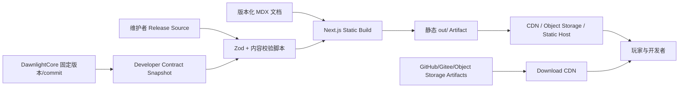
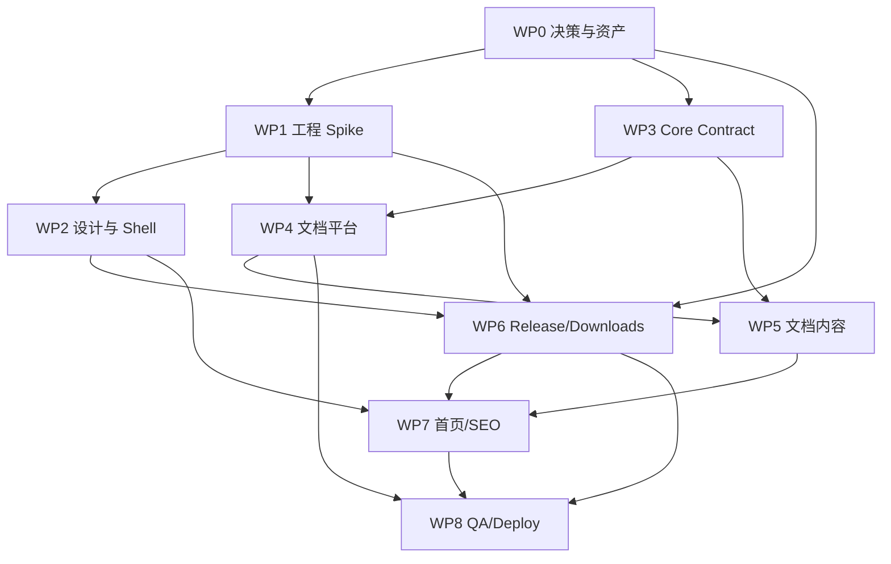

# DawnlightCore 网站 V1 详细实现方案

状态：待实施

编写日期：2026-08-16

上位文档：[DawnlightCore 网站整体开发文档](./DawnlightCoreWebsiteDevelopmentPlan.md)

适用范围：第一版开发者门户与官方下载站

## 1. 文档目的

本文将总体开发文档中的“阶段 0：公共合同准备”和“阶段 1：开发者门户与官方下载 MVP”细化为可直接执行的第一版实现方案。

文档回答以下问题：

- V1 具体包含和不包含什么；
- 第一版采用怎样的代码、内容和部署结构；
- 首页、文档、下载和发布页面如何实现；
- DawnlightCore 源仓库中的规范如何进入网站；
- 发布清单、版本选择、搜索、国际化和设计系统如何落地；
- 每个工作包的输入、输出、依赖和验收标准是什么；
- 上线前必须完成哪些测试、内容和运维准备。

## 2. V1 定义

V1 是一个可正式公开使用的静态开发者门户和官方下载站，而不是演示原型。

V1 必须让两类用户完成端到端任务：

1. 玩家能够确认平台和运行要求，下载正确的 DawnlightCore artifact，核对 SHA-256，并查看对应更新日志；
2. 光影开发者能够进入版本正确的中文文档，创建一个最小光影包，理解 Manifest v3 的核心结构，并使用生产 CLI 得到可定位的验证结果。

V1 不启动业务后端。构建和开发使用 Node.js/TypeScript，生产站点输出静态 HTML、CSS、JavaScript、图片、搜索索引和 JSON feed，可部署到 CDN 或对象存储。

## 3. V1 技术决策摘要

| 领域 | V1 决策 |
|---|---|
| 前端 | Next.js App Router + TypeScript strict |
| 文档 | Fumadocs + MDX |
| 样式 | Tailwind CSS + CSS Variables |
| 交互原语 | Radix UI，按需采用 shadcn/ui 实现 |
| 图标 | Lucide |
| 国际化 | next-intl；首发只发布完整中文内容 |
| 搜索 | 构建期生成的按语言/版本拆分 Orama 静态索引 |
| 数据校验 | Zod 校验站点配置、文档 frontmatter 和 release feed |
| 图片 | 构建期生成 AVIF/WebP/JPEG 衍生图；生产不依赖图片优化服务 |
| 测试 | Vitest + Testing Library + Playwright + axe |
| Workspace | pnpm workspace；保留未来 `apps/api`、`apps/worker` 扩展位置 |
| 构建编排 | Turborepo |
| 生产运行时 | 无业务服务，使用 Next.js static export |
| 发布数据 | 仓库内版本化 release source，构建出公开 JSON feed |
| 下载 | 直接链接到 Release/对象存储/CDN，不经过网站服务器 |
| 分析 | 默认不接入；如需要仅采用无 Cookie、隐私友好的统计 |

V1 不安装或初始化 NestJS、Prisma、PostgreSQL、pg-boss、TanStack Query、React Flow 或 Meilisearch。它们属于后续阶段，不能因为整体架构中已选型就在第一版产生空工程和维护成本。

## 4. V1 范围

### 4.1 必须交付

- 中英文可扩展的 locale 路由，首发完整内容为 `zh-CN`；
- 全局 Header、Footer、移动导航、主题切换和搜索入口；
- DawnlightCore 首页；
- 版本化开发文档；
- 文档目录、当前页 TOC、面包屑、上一篇/下一篇；
- JSON、GLSL、PowerShell、C# 代码高亮与复制；
- 文档状态、适用 Core/Manifest 版本和验证版本；
- 中文全文搜索，包括英文 ID 和诊断代码；
- 官方下载页；
- 发布记录列表和发布详情；
- 平台、架构、渠道和图形要求选择；
- 主下载源和镜像；
- 文件名、大小、SHA-256 和复制按钮；
- 机器可读、版本化的公开 release feed；
- 404、内容不存在和构建期数据错误处理；
- SEO、sitemap、robots、Open Graph 基础信息；
- Light/Dark/System 主题；
- 响应式和 WCAG 2.2 AA 基础；
- CI 中的 lint、typecheck、test、build、链接和内容验证；
- 静态部署、缓存规则和回滚流程。

### 4.2 首发文档必须覆盖

- DawnlightCore 是什么，以及 JSON/GLSL/C# Catalog 的边界；
- 当前稳定能力和已知限制；
- 环境、目录和工具准备；
- 第一个最小光影包；
- `shaderpack.json` 和 fragments；
- Options；
- Graphics/Compute Programs 与 defines/variants；
- Resources、content、binding 和 lifetime；
- Passes 和七类命令；
- Semantic、Capability、Service 和 EngineDraw Provider 概览；
- Settings UI、condition、翻译和覆盖规则；
- `ShaderPackCli` 安装和验证；
- 常见诊断的查找方法；
- BuiltIn Minimal 与 External Complete 的区别；
- 从最小包继续构建完整光影的路线；
- 版本兼容和迁移规则。

## 5. V1 非范围

第一版明确不实现：

- 用户注册、登录和账户；
- Shader 社区浏览、项目页和用户投稿；
- NestJS API、数据库、对象存储上传和后台队列；
- 在线上传或服务端验证光影包；
- Diagnostic Explorer 独立工具页；
- Catalog Explorer 独立工具页；
- Pipeline Graph Viewer；
- Variant Explorer；
- 评论、评分、收藏、关注和下载排行榜；
- 自动更新客户端；
- WebSocket、实时通知或 Service Worker；
- 未完成的英文文档入口；
- 仅为了表达“未来会有”而存在的空白社区或工具页面。

未实现的主导航项不得显示为禁用按钮。“光影”和“工具”应在功能具备后再加入全局导航。

## 6. V1 成功指标

### 6.1 核心任务指标

- 从首页到开始阅读快速开始不超过两次操作；
- 从首页到开始下载稳定 artifact 不超过两次操作；
- 下载页能在不阅读长篇说明的情况下回答平台、要求、大小、hash 和来源；
- 搜索 `P9UI203`、`historyCommit`、`drawbuffers`、`设置菜单` 能定位正确页面；
- 所有首发示例经过固定 Core commit/version 对应的生产 Loader 验证；
- 网站中不存在没有适用版本标识的规范页面；
- 移动端可完整浏览文档和下载，不依赖桌面 hover；
- 任何错误 artifact URL、hash 格式或重复 ID 都会使 CI 失败，而不是上线后暴露。

### 6.2 工程指标

- `pnpm install --frozen-lockfile` 后可在干净环境完成构建；
- 所有生成步骤有独立命令且可在 CI 重现；
- 静态构建不需要 Dawnlight 游戏源码目录存在；
- Core 合同输入由 lock 文件记录版本、commit 和 SHA-256；
- 生产输出不包含本机绝对路径；
- 无运行时数据库、Node API 或私密环境变量依赖；
- 发布可通过重新指向上一静态 artifact 快速回滚。

## 7. 前置条件与上线门禁

### 7.1 必须在开发开始时确认

| 决策 | 要求 |
|---|---|
| 网站正式名称 | `DawnlightCore` 的大小写、中文说明和产品归属 |
| 首发域名 | 用于 canonical URL、sitemap 和 Open Graph |
| 首发渠道 | stable 是否已有可公开版本；没有时只能发布 preview 文档 |
| 版本轴 | Core 产品版本、公共 ABI、Manifest v3、Settings UI v1 的显示方式 |
| 下载来源 | GitHub、Gitee、R2、COS/OSS 或组合 |
| 截图和 Logo | 来源、授权、版本和可公开性 |
| 包许可证 | 官方包和示例包的许可证/来源说明 |
| 支持平台 | 下载页实际展示的平台、架构和图形要求 |

### 7.2 V1 最小 Developer Contract

V1 不等待所有后续工具完成，但至少需要以下不可变输入：

```text
metadata.json
schemas/shaderpack.schema.json
schemas/settings-ui.schema.json
catalogs/summary.json
diagnostics/diagnostics.json
examples/minimal/
examples/settings-auto/
examples/settings-authored/
cli/metadata.json
```

如果正式生成器尚未完成，允许第一次使用“人工导出但有 commit 和 hash 的临时快照”。临时快照必须满足：

- 来源 commit 固定；
- 文件纳入网站仓库或不可变 release artifact；
- `contract-lock.json` 记录 SHA-256；
- 示例通过对应 commit 的生产 Loader；
- 页面明确标记 preview，而不是伪装为稳定规范；
- 后续自动生成器可替换输入而不改变网站消费合同。

### 7.3 不阻塞 V1 的增强能力

以下内容可延后到网站阶段 2：

- `catalog list --json` 的完整字段；
- `graph dump --json`；
- `variant explain --json`；
- 在线上传验证；
- 所有诊断代码的交互式独立页面；
- 文档版本 diff。

## 8. V1 总体架构



生产环境不进行动态 fetch 来决定发布版本。所有公开页面和 feed 在构建时由经过校验的本地 source 生成，使一次部署具有确定内容。

## 9. 仓库结构

V1 推荐结构：

```text
dawnlight-core/
├─ apps/
│  └─ web/
│     ├─ app/
│     │  └─ [locale]/
│     ├─ components/
│     │  ├─ layout/
│     │  ├─ docs/
│     │  ├─ downloads/
│     │  └─ ui/
│     ├─ lib/
│     │  ├─ content/
│     │  ├─ releases/
│     │  ├─ search/
│     │  └─ site/
│     ├─ messages/
│     ├─ styles/
│     ├─ public/
│     ├─ source.config.ts
│     └─ next.config.ts
├─ content/
│  ├─ docs/
│  │  └─ zh-CN/
│  │     └─ preview-or-version/
│  └─ releases/
│     ├─ releases.json
│     └─ notes/
├─ contracts/
│  └─ dawnlight/
│     └─ preview-or-version/
│        ├─ contract-lock.json
│        ├─ schemas/
│        ├─ catalogs/
│        ├─ diagnostics/
│        └─ examples/
├─ scripts/
│  ├─ sync-dawnlight-contract.mts
│  ├─ validate-contract.mts
│  ├─ validate-content.mts
│  ├─ validate-releases.mts
│  ├─ build-search-index.mts
│  ├─ generate-release-feed.mts
│  └─ optimize-images.mts
├─ tests/
│  ├─ e2e/
│  └─ fixtures/
├─ docs/
├─ pnpm-workspace.yaml
├─ turbo.json
├─ package.json
└─ pnpm-lock.yaml
```

### 9.1 结构约束

- MDX 只存放公开解释性内容；
- Schema、Catalog 和诊断数据只存放于 `contracts/dawnlight/{version}`；
- release source 只有一份，公开 feed 是生成物；
- 示例代码从 contract/example 文件引用，避免复制到 MDX 后漂移；
- UI 组件先保留在 `apps/web`，在出现第二个真实消费者前不创建空 `packages/ui`；
- V1 不创建空 `apps/api` 和 `apps/worker`；
- 生成的搜索索引和静态 feed 不作为手工编辑源。

## 10. 工具链与工程配置

### 10.1 Runtime

- 使用实现时受支持的 Node.js LTS；
- `packageManager` 固定 pnpm 版本；
- 通过 Corepack 启用 pnpm；
- TypeScript 开启 `strict`、`noUncheckedIndexedAccess` 和一致的 module resolution；
- 生产和 CI 使用相同 Node/pnpm major；
- 不使用全局安装工具完成构建。

### 10.2 根命令

V1 应提供：

```text
pnpm dev
pnpm build
pnpm lint
pnpm format:check
pnpm typecheck
pnpm test
pnpm test:e2e
pnpm validate:content
pnpm validate:releases
pnpm validate:contract
pnpm generate
pnpm check
```

`pnpm check` 按稳定顺序执行格式、lint、类型、内容、合同、单元测试和生产构建。E2E 可在 build 后单独运行，避免本地快速检查过慢。

### 10.3 代码规范

- ESLint 使用 Next.js、TypeScript 和无障碍规则；
- Prettier 负责 TS/JSON/Markdown 基础格式；
- import 顺序由单一工具管理，不叠加冲突插件；
- 禁止 `any` 逃逸，确需使用时必须收窄到边界模块；
- 外部 JSON 一律先经过 Zod 解析，不直接类型断言；
- UI 文案不得直接散落在组件中，进入 locale message 或内容文件；
- 日期、大小、版本和平台显示统一 formatter；
- 不把环境变量读取分散在组件中，统一通过校验后的 config 模块。

## 11. 静态输出策略

### 11.1 Next.js 配置

V1 目标为 `output: 'export'`：

- 所有公开路由可在构建时枚举；
- 不使用 Route Handler、Server Action、动态 Cookie 或运行时数据库；
- 不使用 Next.js middleware 做 locale 检测或重定向；
- 版本、locale 和 release detail 使用 `generateStaticParams`；
- 站点配置和 release source 在构建时读取；
- 使用 `trailingSlash` 以提高对象存储托管兼容性；
- 图片不依赖 Next.js 在线 optimizer；
- sitemap、robots 和 release feed 输出为静态文件。

### 11.2 静态搜索

不依赖 `/api/search`。构建脚本为每个公开 locale/version 生成独立索引：

```text
/search-index/zh-CN/{coreVersion}.json
```

搜索 Dialog 打开后再加载当前版本索引；只有用户选择“所有版本”时才加载其他索引。索引不可包含未发布、internal 或 preview 禁止公开的页面。

### 11.3 技术 Spike

工程初始化后的第一项验证必须是一个小型 production spike：

1. Fumadocs + locale + version 路由可静态导出；
2. 一篇 MDX、目录和代码高亮可静态工作；
3. 静态 Orama 索引可在无服务器环境搜索中文和英文 ID；
4. 主题切换在静态页面无明显闪烁；
5. 部署目标能正确处理 trailing slash、404 和缓存。

Spike 未通过前不批量编写页面，避免内容建立在不可部署的路由结构上。

## 12. 站点配置合同

建立单一 `site.config.ts`，至少包含：

```ts
type SiteConfig = {
  name: string;
  description: string;
  canonicalOrigin: string;
  defaultLocale: "zh-CN";
  publishedLocales: readonly string[];
  defaultDocsVersion: string;
  docsVersions: readonly {
    id: string;
    label: string;
    status: "preview" | "stable" | "maintained" | "archived";
    contractPath: string;
  }[];
  sourceRepository?: string;
  issueTracker?: string;
};
```

约束：

- Production 必须显式提供合法 HTTPS canonical origin；
- default docs version 必须存在且公开；
- published locale 必须有完整 message 和最小内容集；
- preview 版本默认添加 `noindex`，除非正式决定公开索引；
- 不从多个环境变量和 JSON 文件拼接相同配置。

## 13. 路由与导航

### 13.1 V1 路由

```text
/{locale}/
/{locale}/docs/{coreVersion}/
/{locale}/docs/{coreVersion}/{...slug}/
/{locale}/downloads/
/{locale}/releases/
/{locale}/releases/{releaseId}/
/{locale}/legal/licenses/
/{locale}/404/
```

根 `/` 通过静态托管规则以 308 重定向到 `/zh-CN/`，同时保留一个带 canonical 和明确链接的静态 fallback `index.html`，避免不支持重定向规则的对象存储返回空页。V1 不使用 Next.js middleware，也不基于 IP 自动切换语言。

### 13.2 V1 主导航

- 文档；
- 下载；
- 发布记录。

右侧：

- 搜索；
- 文档版本；
- 主题；
- 语言仅在至少两个完整 locale 发布后显示。

移动端用 Menu 图标打开全高或适当宽度抽屉。常用下载操作不隐藏在三层菜单中。

### 13.3 链接规则

- 内部链接使用 locale 和版本感知 helper；
- 文档引用默认保持当前版本；
- 跨版本链接必须显式标注目标版本；
- 外部链接使用图标或辅助文本标识；
- 新标签页只用于下载或确有必要的外部工具；
- 所有外链在构建或定期 CI 中检查；
- 不生成指向本机源码绝对路径的公开链接。

## 14. 首页实现规格

### 14.1 目标

首页不是功能说明书。用户进入后应立即识别 DawnlightCore、看到实际画面，并选择下载或开发文档。

### 14.2 页面结构

1. 全宽真实游戏画面 hero；
2. `DawnlightCore` H1 和一句准确说明；
3. “下载稳定版”和“开始开发光影”两个主要入口；
4. 当前发布摘要：Core、Manifest、日期、平台；
5. 开发者快速入口：快速开始、Manifest、Settings UI、CLI；
6. 当前能力与限制的紧凑摘要；
7. 最新三条发布记录；
8. Footer。

### 14.3 Hero 资产要求

- 必须使用 Dawnlight 实际运行截图；
- 主体可辨认，不能整体压暗或模糊；
- 至少提供宽屏和移动端裁切；
- 文字区域通过真实构图和克制遮罩保证对比度；
- 提供 AVIF、WebP 和 fallback；
- LCP 主图设置明确尺寸和优先加载；
- 记录截图所用 DawnlightCore、shader pack、场景和作者；
- 未取得可公开授权的资产不能进入生产。

### 14.4 首页验收

- 360px 到宽屏无文字和按钮重叠；
- Hero 不占满全部视口，底部能看到下一节线索；
- 首屏只有一个主下载入口和一个开发入口；
- 当前版本来自 release source，不手写两份；
- 没有“功能即将上线”空卡片；
- 无 JavaScript 时仍可读取核心信息和使用链接。

## 15. 文档系统实现规格

### 15.1 内容目录

推荐首发结构：

```text
00-overview/
  introduction.mdx
  capabilities-and-limitations.mdx
01-getting-started/
  prerequisites.mdx
  first-minimal-pack.mdx
  validate-with-cli.mdx
02-concepts/
  package-model.mdx
  trusted-catalog-boundary.mdx
  generation-and-lifecycle.mdx
03-manifest/
  root-and-fragments.mdx
  options.mdx
  programs.mdx
  defines-and-variants.mdx
  resources.mdx
  passes-and-commands.mdx
  semantics-and-bindings.mdx
04-settings-ui/
  overview.mdx
  pages-groups-controls.mdx
  conditions.mdx
  localization.mdx
05-guides/
  fullscreen-pass.mdx
  compute-pass.mdx
  history-resource.mdx
  complete-pack-roadmap.mdx
06-reference/
  manifest-fields.mdx
  command-types.mdx
  diagnostics.mdx
  limits.mdx
07-migration/
  version-policy.mdx
```

内容树的显示名称由 Fumadocs metadata 文件控制，不依赖文件名前缀直接显示。

### 15.2 Frontmatter Schema

```ts
const docsFrontmatterSchema = z.object({
  title: z.string().min(1).max(120),
  description: z.string().min(1).max(240),
  coreVersion: z.string().min(1),
  manifestVersion: z.number().int().positive().optional(),
  settingsSchemaVersion: z.number().int().positive().optional(),
  status: z.enum(["preview", "stable", "experimental", "deprecated"]),
  lastVerifiedWith: z.string().min(1),
  sourceRefs: z.array(z.string()).default([]),
  searchAliases: z.array(z.string()).default([]),
});
```

`lastVerifiedWith` 不是自由宣传文本，必须指向 contract lock 中存在的 Loader/Core 版本。

### 15.3 文档布局

桌面：

```text
Header
Breadcrumb + version/status
Left navigation | Article | On-this-page
Previous / Next
Footer
```

要求：

- 左侧树支持当前位置展开、键盘操作和滚动保留；
- 右侧 TOC 只显示当前文章层级，不重复整个导航；
- 正文约 72ch；
- 宽表格和代码在自身容器滚动；
- 标题锚点可复制；
- deprecated/experimental 以页面级 banner 显示；
- 文档版本切换优先寻找同 slug 页面，不存在时回到目标版本首页并说明；
- 上一篇/下一篇遵循 authored order，而不是文件系统偶然顺序。

### 15.4 代码与示例

`VerifiedCodeBlock` 展示：

- 语言；
- 来源相对路径；
- 验证状态；
- Core/CLI 版本；
- 复制按钮；
- 可选“查看完整文件”。

完整 JSON/GLSL 从 contract examples 读取。MDX 中的小片段可以手写，但必须标记 `illustrative`，不能显示“已验证”。

### 15.5 Callout 类型

只提供语义明确的 callout：

- Note；
- Important；
- Warning；
- Unsupported；
- Version-specific。

禁止仅为视觉装饰连续堆叠 callout。限制和危险行为必须使用文字标题，不能只靠颜色。

## 16. 首发文档来源与改写计划

内部文档是事实来源之一，但公开内容必须重新组织。

| 公开主题 | 主要来源 | 改写要求 |
|---|---|---|
| 能力与限制 | `ShaderPackDeveloperFreedomAssessment.md` | 删除内部计划语气，保留公开可验证能力和明确限制 |
| Manifest composition | `ShaderPackManifestComposition.md` | 转为字段参考、失败规则和完整示例 |
| 完整包结构 | `DawnlightV31ManifestSkeleton.md` | 提取可迁移模式，不把 Dawnlight 特有选择描述为通用要求 |
| Program variants | `DawnlightProgramDefinesAndVariants.md` | 解释 literal/option/capability define 和 fingerprint |
| Commands | `DawnlightGenericCommandTypes.md` 及 Manifest 实现 | 覆盖七类命令、资源访问和适用 scope |
| Semantics | `DawnlightSemanticProviderCatalog.md` | 标明 Catalog 版本和公开稳定程度 |
| Resources | `DawnlightResourceContentAndFactoryServices.md` | 分开 resource descriptor、content 和可信 factory/service |
| Settings UI | `ShaderPackSettingsUiReference.md` | 保留字段、限制、诊断和 CLI，补充教程式入口 |
| 最小包 | BuiltIn shaders 和测试 fixture | 创建独立、可下载、经 Loader 验证的作者示例 |
| 完整示例 | Dawnlight v3.1 | 作为纵向示例，不声称其证明横向通用性 |

### 16.1 内容写作规则

- 中文术语首次出现时给出稳定英文 ID；
- JSON property、Program ID、diagnostic code 保持原始大小写；
- “必须”“可以”“当前不支持”严格区分；
- 不以源码内部类名代替公共概念，除非它本身是公共合同；
- 每页开头说明读者、前置知识和完成结果；
- 每个教程以一个可验证产物结束；
- 不复制 P8/P9 历史任务、commit 记录和内部验收清单；
- 当前限制必须能链接到能力矩阵或已知限制页。

## 17. 下载页实现规格

### 17.1 页面目标

下载页是一个选择和核对工具，不是多个大卡片组成的宣传页。

### 17.2 页面结构

1. 当前稳定版摘要；
2. 发布渠道切换：Stable/Beta，仅显示实际存在渠道；
3. 平台 segmented control；
4. 架构或兼容 variant 选择；
5. 推荐 artifact 主区域；
6. 运行要求；
7. 文件名、大小、SHA-256、签名状态；
8. 主下载按钮和镜像菜单；
9. 安装步骤；
10. 其他版本和发布记录入口。

平台使用图标加文字，不能只有图标。选项少时使用 segmented control，variant 较多时使用 Select/Menu。

### 17.3 行为

- 默认只根据 User-Agent 提供建议，不自动下载；
- 浏览器无法可靠判断的架构、GPU 和兼容补丁必须由用户选择；
- 用户选择保存在 localStorage，但 URL query 优先且可分享；
- query 中非法值回退并显示清晰状态，不抛出页面异常；
- 推荐规则输出原因，例如“Windows x64，OpenGL ES 3.2”；
- 没有完全匹配时显示所有要求和手动选择，不隐藏下载；
- 点击下载直接使用 HTTPS artifact/mirror URL；
- Hash 复制按钮使用 Copy 图标和 Tooltip；
- 下载按钮文本包含动作和目标，例如“下载 Windows x64”；
- withdrawn artifact 禁止作为推荐项，并显示安全说明或替代版本。

### 17.4 安装说明

每个平台说明来自结构化或独立内容文件，不能塞进 release feed 的长字符串。要求：

- 前置运行时；
- 最低系统版本；
- Graphics API 要求；
- 解压/安装步骤；
- 首次运行注意事项；
- 常见失败和对应文档；
- 兼容补丁的适用范围；
- 不使用恐吓或不准确硬件描述。

## 18. 发布记录实现规格

### 18.1 列表页

- 按发布时间降序；
- 显示版本、渠道、日期、摘要和支持平台；
- Stable/Beta badge 使用固定语义和颜色；
- 支持按渠道筛选；
- 不用无限滚动，版本数量较少时直接分页或完整列表；
- withdrawn/yanked 版本保留记录并明确状态。

### 18.2 详情页

- 版本和渠道；
- 发布时间；
- 更新摘要与完整 changelog；
- Breaking Changes、Added、Changed、Fixed、Known Issues；
- artifact 表格；
- SHA-256 和签名；
- 对应文档版本；
- 升级/回滚注意事项；
- 前一版和后一版链接。

Changelog 由受信任 MDX 内容提供，release JSON 保存 path 或稳定 ID，不重复保存大段 Markdown。

## 19. Release Feed 设计

### 19.1 Source 与公开 Feed

- `content/releases/releases.json` 是维护者编辑源；
- `generate-release-feed.mts` 校验并生成公开 feed；
- 页面构建读取同一份已解析 domain model；
- `apps/web/public/feeds/releases-v1.json` 是生成物；
- `apps/web/public/feeds/releases-v1.json.sig` 是可选 preview、生产必需的 detached signature；
- CI 检查生成物与 source 一致，或部署时只从构建 artifact 取生成物；
- 不允许页面、首页和 feed 各自维护版本字符串。

### 19.2 V1 数据形状

```ts
type ReleaseFeedV1 = {
  schemaVersion: 1;
  generatedAt: string;
  signingKeyId?: string;
  releases: ReleaseV1[];
};

type ReleaseV1 = {
  id: string;
  version: string;
  channel: "stable" | "beta" | "nightly";
  status: "available" | "withdrawn" | "archived";
  publishedAt: string;
  summary: string;
  coreApiVersion?: string;
  supportedManifestVersions: number[];
  docsVersion: string;
  releaseNotes: string;
  artifacts: ArtifactV1[];
};

type ArtifactV1 = {
  id: string;
  platform: "windows" | "android" | "linux" | "ios" | "web";
  architecture: "x64" | "arm64" | "wasm" | "universal";
  variant: string;
  fileName: string;
  size: number;
  sha256: string;
  graphics: {
    api: string;
    minimumVersion?: string;
    features: string[];
  };
  primary: DownloadLocationV1;
  mirrors: DownloadLocationV1[];
  signature?: {
    algorithm: string;
    keyId: string;
    url: string;
  };
};

type DownloadLocationV1 = {
  id: string;
  label: string;
  region: "global" | "china" | "other";
  url: string;
};
```

正式实现时由 Zod Schema 产生 TypeScript 类型和可选 JSON Schema，不手写三份等价定义。

### 19.3 校验规则

- release/artifact/location ID 全局或作用域内唯一；
- 时间为 UTC ISO 8601；
- `generatedAt` 来自 `SOURCE_DATE_EPOCH` 或受控发布 metadata，不能直接读取构建机器当前时间导致相同输入产生不同 feed；
- releases 按发布时间排序或生成器稳定排序；
- stable 同一版本不可重复；
- `docsVersion` 必须存在；
- `releaseNotes` 必须指向现有文件；
- artifact size 为正整数；
- SHA-256 为 64 位小写十六进制；
- URL 只能是 HTTPS，host 在显式 allow-list；
- fileName 不含路径；
- withdrawn 不能作为 latest/recommended；
- 至少一个可用 release 才能生成下载页；
- 镜像 ID 不重复，且不能指向同一 URL；
- 生成 feed 不包含本机路径和内部备注。

生产 feed 使用 canonical UTF-8 JSON bytes 生成 detached Ed25519 signature。签名密钥只存在于发布环境；普通 Pull Request 只验证 canonicalization 和测试密钥 fixture。`signingKeyId` 用于选择公开密钥，不能把私钥或可签名凭据放入 Next.js 环境变量。Artifact 自身如有 detached signature，则通过 `ArtifactV1.signature` 展示；没有签名时 UI 必须明确显示“仅提供 SHA-256”，不能伪造已签名状态。

## 20. Artifact 推荐逻辑

V1 使用纯函数实现并单独测试：

```text
输入：channel、platform、architecture、variant、release status
输出：recommended artifact、alternatives、reason、compatibility state
```

算法：

1. 只考虑 `available` release；
2. 按显式 URL query 选择，优先级最高；
3. 其次使用用户上次选择；
4. User-Agent 只建议 platform，不推断 GPU；
5. 选择目标 channel 最新 release；
6. 精确匹配 platform 和 architecture；
7. variant 不明确时使用 release source 标记的默认 variant；
8. 无精确匹配时返回 alternatives，不伪装为兼容；
9. 返回人类可读 reason 和机器状态；
10. 函数不直接读 localStorage、window 或 React state。

必须测试：未知平台、无 artifact、withdrawn latest、重复 variant、非法 query、多个镜像和兼容补丁选择。

## 21. 国际化策略

### 21.1 首发范围

- 首发完整 locale 为 `zh-CN`；
- UI message key 从第一天集中管理；
- 英文内容未达到完整最小集时不发布 `/en-US`，也不显示语言切换；
- 代码 ID、JSON property 和 diagnostic code 不翻译；
- 日期、数字和文件大小按 locale 格式化。

### 21.2 URL 与 fallback

- locale 始终出现在 URL；
- UI message 缺失在 CI 中报错，不静默显示 key；
- 文档不跨语言逐段 fallback，缺少整页时回到该语言文档首页并说明；
- 项目未来的用户生成内容可以保留作者语言，但 V1 尚不涉及。

### 21.3 中文排版

- 中文与英文/数字之间的空格按项目统一风格；
- 标点使用中文标点，代码和路径除外；
- 长英文 ID 允许换行或在 code 容器滚动；
- 不使用负 letter spacing；
- CJK 字体优先系统字体，避免下载完整大型字体包。

## 22. 设计系统 V1

### 22.1 设计 token

第一批 token：

```text
color.background
color.surface
color.surfaceSubtle
color.foreground
color.foregroundMuted
color.border
color.borderStrong
color.brand
color.brandForeground
color.info
color.success
color.warning
color.danger
color.focusRing
color.codeBackground

space.1 ... space.12
radius.1 ... radius.3
font.body
font.mono
fontSize.body/small/label/h1/h2/h3
lineHeight.body/compact/code
layout.content/docs/wide
control.heightSm/heightMd/heightLg
```

Token 在 CSS Variables 定义 Light/Dark 值。组件不得用 Tailwind arbitrary color 绕过语义 token。

### 22.2 色彩方向

- 中性灰/炭黑作为背景和表面；
- 晨光金或琥珀作为品牌与主要动作；
- 青/蓝用于信息，绿用于成功，橙用于警告，红用于错误；
- 不使用单一蓝黑色覆盖全部 UI；
- 不使用紫蓝渐变、玻璃拟态和装饰性发光；
- syntax colors 单独平衡，不能让代码块成为整页唯一高饱和区域。

正式颜色在设计 Spike 中通过 Light/Dark 对比度测试后冻结，不在计划阶段凭视觉偏好写死不合格值。

### 22.3 字体和字号

- 拉丁使用自托管 Inter 或系统 sans；
- CJK 使用 `PingFang SC`、`Microsoft YaHei`、系统 sans fallback；
- 代码使用 JetBrains Mono/system monospace；
- 正文约 16px，文档 line-height 约 1.7；
- 首页 H1 约 36-48px 范围，通过固定断点调整，不使用 `vw`；
- 面板、下载和导航使用紧凑标题；
- letter spacing 为 0。

### 22.4 组件规则

- 圆角不超过 8px；
- 只在重复项目、弹窗和真正工具区域使用 Card；
- 页面 section 不做悬浮卡片；
- 禁止 Card 内嵌 Card；
- 二元选项使用 toggle/checkbox；
- 平台等少量互斥模式使用 segmented control；
- 多选项使用 menu/select；
- 复制、主题、菜单等按钮使用 Lucide 图标和 Tooltip；
- 文本按钮只用于明确命令；
- hover、loading 和 badge 内容变化不能改变固定控件尺寸。

## 23. V1 组件清单

### 23.1 Layout

- `SiteHeader`；
- `DesktopNavigation`；
- `MobileNavigation`；
- `SiteFooter`；
- `ThemeToggle`；
- `SearchTrigger`；
- `LocaleSwitcher`，仅多 locale 时渲染；
- `DocsVersionSwitcher`；
- `PageContainer`；
- `SkipToContent`。

### 23.2 文档

- `DocsSidebar`；
- `DocsBreadcrumbs`；
- `DocsToc`；
- `DocsPager`；
- `DocsStatusBanner`；
- `VersionBadge`；
- `ManifestVersionBadge`；
- `VerifiedCodeBlock`；
- `FieldReferenceTable`；
- `Callout`；
- `HeadingAnchor`；
- `SearchDialog`；
- `SearchResultItem`。

### 23.3 下载和发布

- `ReleaseChannelControl`；
- `PlatformControl`；
- `ArchitectureSelect`；
- `VariantSelect`；
- `ArtifactRecommendation`；
- `ArtifactMetadata`；
- `DownloadButton`；
- `MirrorMenu`；
- `ChecksumField`；
- `RequirementsList`；
- `ReleaseList`；
- `ReleaseStatusBadge`；
- `ArtifactTable`。

### 23.4 通用状态

- `EmptyState`；
- `InlineError`；
- `NotFoundView`；
- `UnsupportedNotice`；
- `CopyButton`；
- `ExternalLink`；
- `Skeleton` 仅用于真正异步交互，静态页面不滥用。

每个组件先定义责任、状态和无障碍要求，再实现样式。组件 Storybook 不作为 V1 必需项；使用专门的开发 preview route 或测试 fixture 即可。

## 24. 搜索实现

### 24.1 索引内容

每个文档记录包含：

- title；
- description；
- headings；
- normalized plain text；
- slug；
- locale；
- Core version；
- status；
- search aliases；
- public ID/diagnostic code tokens。

代码块正文默认不完整进入索引，避免大量 JSON 噪声；字段 ID、命令 ID 和诊断代码通过 aliases/显式 metadata 加入。

### 24.2 搜索 UI

- `Ctrl/Cmd + K` 打开；
- `/` 可在非输入环境聚焦搜索；
- 输入法 composition 期间不错误提交；
- 按标题、章节和描述显示结果；
- 每条结果显示 Core 版本和状态；
- 键盘上下选择、Enter 打开、Escape 关闭；
- 空结果提供修改关键词和查看文档树入口；
- 索引加载失败时仍允许用户浏览导航，不出现空白 Dialog。

### 24.3 搜索测试词

至少固化：

```text
P9UI203
historyCommit
drawbuffers
textureCube
Compute
设置菜单
条件依赖
资源生命周期
最小光影包
```

每个词都有预期首条或前几条结果，作为搜索回归测试。

## 25. 图片与静态资产流水线

### 25.1 源资产

源图放在不直接公开的 assets source 目录，记录：

- 文件 ID；
- 作者/来源；
- 许可证或授权；
- 生成/拍摄日期；
- 游戏、Core 和光影版本；
- 场景和关键设置；
- 允许使用范围。

### 25.2 构建衍生图

`optimize-images.mts` 使用成熟图片库生成固定尺寸：

- hero desktop；
- hero mobile；
- release/social preview；
- docs inline；
- fallback JPEG/WebP。

规则：

- 输出文件名包含内容 hash；
- 限制像素总量；
- 清理不必要 metadata；
- 保留必要色彩配置；
- 禁止构建时从不稳定外站抓取关键图；
- CI 检查实际尺寸和缺失 alt metadata。

## 26. SEO 与分享

### 26.1 Metadata

- 每页独立 title 和 description；
- canonical URL 包含 locale 和具体 docs version；
- preview docs 根据决策设置 `noindex`；
- Open Graph 使用实际 Dawnlight 图像，不使用抽象模板图；
- release detail 包含版本和发布日期；
- docs article 可输出 TechArticle 基础结构化数据；
- downloads 页面避免以多个 query 组合产生重复可索引页面。

### 26.2 Sitemap

- 只包含公开 locale；
- 只包含实际发布的文档版本；
- 排除 internal、404 和任意 query；
- withdrawn release 是否保留由安全/历史策略决定，默认保留详情但降低优先级；
- sitemap 由构建内容树生成，不手工维护。

### 26.3 404

404 提供：

- 简明说明；
- 返回当前语言首页；
- 进入文档；
- 搜索；
- 不显示错误堆栈或内部 route 信息。

## 27. 安全与隐私 V1

V1 无账户、表单和用户内容，但仍需：

- 全站 HTTPS；
- HSTS；
- `X-Content-Type-Options: nosniff`；
- 合理的 `Referrer-Policy`；
- `Permissions-Policy` 禁用不使用能力；
- `frame-ancestors 'none'` 或等价防嵌套策略；
- CSP 在 staging 先 report-only，验证 Next static inline script/style 后再执行；
- release 外链只允许 HTTPS 和维护者 allow-list host；
- MDX 只来自受信任仓库，不允许任意 HTML；
- 不在构建日志和客户端 bundle 中写入私密 token；
- 不加载第三方远程字体；
- 默认不设置分析 Cookie；
- 外部下载链接与镜像明确显示域名/来源。

静态 CSP 如果需要 build-specific script hash，应由构建脚本生成，不能为了省事永久保留无限制 `unsafe-inline`。

## 28. 无障碍实施

### 28.1 必须行为

- 页面顶部提供 Skip to content；
- Header、Nav、Main、Aside、Footer 使用正确 landmark；
- 所有操作键盘可达；
- focus 顺序与视觉顺序一致；
- 主题和复制图标按钮有 accessible name 和 Tooltip；
- 移动导航打开时正确管理 focus 和滚动锁；
- Search Dialog 使用合适 combobox/listbox 行为；
- 代码复制结果通过克制的 live region 提示；
- 状态 badge 同时包含文字；
- SHA-256 可选择、可复制，不只显示截断值；
- 表格有 header 和移动端可访问策略；
- 尊重 `prefers-reduced-motion`。

### 28.2 验收

- axe 自动检查无严重/关键问题；
- 仅键盘完成首页、搜索、文档和下载流程；
- Windows 高对比或 forced-colors 下主要功能可辨认；
- 200% zoom 不丢失内容；
- 状态、错误和选中项不只依赖颜色；
- 中文屏幕阅读器基础朗读顺序人工抽查。

## 29. 性能预算

### 29.1 页面预算

- 首页、文档首页和下载页 Lighthouse Performance 目标至少 90；
- Accessibility、Best Practices、SEO 目标至少 95；
- LCP 目标小于 2.5s，CLS 小于 0.1，INP 小于 200ms；
- 首屏不加载所有文档搜索索引；
- 首页不加载 React Flow、Monaco、TanStack Table 等 V1 未使用依赖；
- 关键 hero 衍生图按视口控制体积，首屏不下载原始超大截图；
- 不下载完整 CJK Web Font；
- 静态页面无多余轮询和 hydration-only 数据获取。

### 29.2 构建预算

- 记录各 route JS 和静态输出大小；
- 搜索索引按版本/locale 拆分并压缩；
- 大于阈值的图片、JSON 和 chunk 使 CI 警告或失败；
- Source map 只按部署策略上传到错误平台，不公开敏感源码路径；
- 批量文档版本不能导致所有版本内容进入任一页面客户端 bundle。

## 30. 测试方案

### 30.1 单元测试

- site config parser；
- docs frontmatter parser；
- release feed parser；
- release latest selection；
- artifact recommendation；
- URL query 与用户偏好解析；
- 文件大小、日期、版本和 hash formatter；
- locale/version-aware link builder；
- search record normalization。

### 30.2 内容测试

- frontmatter 必需字段；
- Core/docs/contract 版本一致；
- 文档树无重复 slug；
- 内部链接存在；
- 外部链接定期检查；
- 图片和 alt metadata 完整；
- sourceRefs 指向 contract 或允许的 Core 文档；
- 示例文件存在；
- verified example 与 CLI 验证记录匹配；
- 不包含本机绝对路径；
- 不包含 internal 页面到公开索引。

### 30.3 组件测试

- ThemeToggle 状态；
- DocsVersionSwitcher 同 slug 和 fallback；
- SearchDialog 键盘交互和 composition；
- Artifact 控件和推荐原因；
- Checksum 复制；
- withdrawn 状态；
- MobileNavigation focus trap；
- Callout 和 status banner 语义。

### 30.4 Playwright E2E

关键流程：

1. 首页 -> 快速开始 -> 搜索 CLI -> 打开验证页面；
2. 首页 -> 下载 -> 选择平台/架构 -> 查看要求 -> 下载链接；
3. 发布列表 -> 详情 -> 对应 artifact 和文档版本；
4. 文档版本切换；
5. 主题切换并刷新保持；
6. 移动导航和文档抽屉；
7. 无匹配 artifact 和非法 query；
8. 404 -> 搜索/首页恢复。

### 30.5 视觉测试

页面：

- 首页；
- 文档首页；
- 长参考页；
- 含宽表格/长代码页；
- 下载页；
- 发布详情；
- Search Dialog；
- 404。

视口：360x800、390x844、768x1024、1280x800、1536x960。Light/Dark 均检查。必须人工查看真实截图，不能只依赖 snapshot diff 数值。

## 31. CI Pipeline

### 31.1 Pull Request

```text
install --frozen-lockfile
-> format:check
-> lint
-> typecheck
-> validate:contract
-> validate:content
-> validate:releases
-> unit/component tests
-> generate static assets/search/feed
-> next build/export
-> start static preview
-> Playwright critical E2E
-> axe checks
-> artifact size report
```

### 31.2 定期任务

- 外部链接检查；
- 下载镜像可达性和 hash metadata 检查；
- 依赖漏洞扫描；
- Lighthouse CI；
- stale docs sourceRef 报告；
- Core 新版本/contract 可用性通知，但不自动更新并发布文档。

### 31.3 Main 部署

只有以下条件满足才部署：

- 所有检查通过；
- 生产 `SITE_ORIGIN` 合法；
- release feed 至少有一个可用版本，或站点明确为 docs-only preview；
- 关键图片和 license metadata 完整；
- 静态 artifact 已保存；
- 部署使用 commit SHA 标记；
- smoke test 成功后才切换正式流量。

## 32. 部署方案

### 32.1 目标

V1 `out/` 是唯一部署 artifact，可部署到：

- Cloudflare Pages/R2；
- Netlify；
- GitHub/Gitee Pages 能力允许的静态托管；
- 阿里云 OSS/Tencent COS + CDN；
- Nginx 静态目录。

具体 provider 通过 ADR 决定，页面代码不得依赖 provider SDK。

### 32.2 缓存

- 带内容 hash 的 JS/CSS/image：`immutable` 长缓存；
- HTML：短缓存或 revalidate 策略，确保发布可见；
- release feed：短缓存并支持 ETag；
- docs contract/static JSON：版本化 URL 长缓存；
- 404 和重定向按 provider 明确配置；
- 回滚切换到上一完整静态 artifact，不逐文件覆盖修复。

### 32.3 Preview 与 Staging

- PR Preview 用于 UI 和内容审阅；
- Preview 默认 `noindex`；
- Staging 使用真实 release source 的只读副本或明确测试 feed；
- 测试下载链接不得与正式 artifact 混淆；
- CSP 先在 staging report-only 验证；
- Preview URL 不进入正式 sitemap。

### 32.4 上线后最低观测

V1 无 API，但仍监控：

- 网站可用性；
- 首页/文档/下载页 HTTP 状态；
- release feed 可解析性；
- 主下载和镜像 URL 可达；
- 真实用户 Core Web Vitals，若选择隐私友好方案；
- 404 高频 URL；
- 部署 commit 和静态 artifact ID。

## 33. 实现工作包

### WP0：决策冻结与资产盘点

输入：总体文档、Core 源仓库、现有 release 和 shader 资产。

任务：

- 确认产品名称、域名、首发文档版本和发布渠道；
- 确认平台、artifact、镜像和运行要求；
- 选择首页截图、Logo、favicon 和授权信息；
- 冻结 V1 route map；
- 创建 contract/release feed ADR；
- 形成内容负责人和技术审核人列表。

输出：ADR、资产清单、内容清单、风险清单。

验收：第 7 节全部上线门禁有明确值或明确 preview 处理。

### WP1：工程基础与静态 Spike

任务：

- 初始化 pnpm workspace 和 Turborepo；
- 创建 `apps/web`；
- 配置 TypeScript、ESLint、Prettier、Vitest；
- 接入 Next.js、Fumadocs、Tailwind、next-intl；
- 实现一篇版本化中文 MDX；
- 建立 static export；
- 建立静态 Orama 搜索最小验证；
- 在目标 host 部署 smoke artifact。

输出：可静态部署的最小网站。

验收：第 11.3 节 Spike 全部通过。

### WP2：设计 token 与站点 Shell

任务：

- 定义 Light/Dark token；
- 建立字体、排版、间距和内容宽度；
- 实现 Header、Footer、导航、主题、Skip Link；
- 实现移动导航；
- 实现 PageContainer、Button、IconButton、Badge、Callout；
- 建立 UI preview fixtures；
- 完成键盘和对比度基础检查。

输出：稳定、响应式站点骨架。

验收：首页空内容、文档长内容和下载表单三类布局均可承载，不产生卡片套卡片和文本重叠。

### WP3：Developer Contract 接入

任务：

- 定义 `contract-lock.json`；
- 编写 contract sync/verify 脚本；
- 导入 Schema、Catalog 摘要、诊断和示例；
- 记录来源 commit、Core/CLI 版本和 SHA-256；
- 建立 VerifiedCodeBlock 数据接口；
- 在 CI 校验示例来源和验证记录；
- 明确临时人工快照的替换路径。

输出：网站可重复消费的固定 Core 合同。

验收：干净构建无需访问开发者本机 Core 路径，且能显示示例来源与验证版本。

### WP4：文档平台与搜索

任务：

- 实现 docs source、目录、frontmatter Schema；
- 实现三栏布局、移动抽屉、TOC、面包屑和 pager；
- 实现版本/status banner；
- 实现代码高亮、复制和标题 anchor；
- 构建静态搜索索引；
- 实现 Search Dialog；
- 增加链接、slug、sourceRef 和 search regression 检查。

输出：可承载全部首发内容的文档产品。

验收：搜索测试词、版本切换、移动导航和宽代码/表格全部通过。

### WP5：首发文档内容

任务：

- 按第 15.1 节创建内容树；
- 从内部文档改写而不是直接复制；
- 创建最小包教程和可下载 example；
- 创建 Manifest/Program/Resource/Pass/Settings UI 核心参考；
- 创建 CLI 和诊断指南；
- 创建能力与限制页；
- 完成技术审核、编辑审核和链接检查。

输出：完整首发中文文档集。

验收：第 4.2 节所有主题有公开页面，新作者路径由非实现者试走并能得到 CLI 验证结果。

### WP6：Release Feed 与下载体验

任务：

- 定义 Zod release Schema；
- 创建真实 release source；
- 编写 feed 生成和校验；
- 实现 latest/recommended pure functions；
- 实现下载页面控件和 metadata；
- 实现镜像菜单、checksum 复制和 requirements；
- 实现 release 列表和详情；
- 增加 URL/local preference 行为；
- 添加单元和 E2E 测试。

输出：可正式使用的下载和发布服务前端。

验收：所有 artifact 可追溯、hash 正确、无非法 host，玩家能在移动和桌面完成下载选择。

### WP7：首页、SEO 与错误页

任务：

- 处理并接入真实 hero 资产；
- 实现首页内容；
- 首页版本摘要复用 release domain model；
- 建立 metadata、canonical、Open Graph；
- 生成 sitemap/robots；
- 实现 404 和内容缺失 fallback；
- 验证 no-JS 核心链接。

输出：完整站点入口和可分享页面。

验收：首页第一视口、SEO、图片性能和无占位内容通过检查。

### WP8：质量、安全与部署

任务：

- 完成 Playwright 关键流程；
- 完成视觉截图和 axe；
- 完成 Lighthouse 和 bundle 检查；
- 配置安全头和 CSP staging；
- 建立 PR Preview 和 production deploy；
- 定义缓存、回滚、smoke 和监控；
- 执行上线清单。

输出：可回滚、可验证的 V1 生产部署。

验收：第 38 节 V1 Definition of Done 全部满足。

## 34. 依赖关系与可并行工作



可并行：

- WP2 与 WP3 在 WP1 Spike 后并行；
- Core 合同准备期间可先建立公开文档大纲，但 verified 内容需等 WP3；
- WP5 内容写作可与 WP6 下载功能并行；
- 截图采集和授权确认应从 WP0 开始，不要等首页开发完成。

关键路径通常是：WP0 -> WP1 -> WP3/WP4 -> WP5 -> WP7 -> WP8。文档内容和 Core 合同质量比页面编码更可能成为工期瓶颈。

## 35. 建议里程碑与工作量

以下为单人主开发、能及时获得 Core 技术确认和视觉资产时的粗略工程量，不是发布日期承诺。

| 里程碑 | 包含 | 估算工作日 |
|---|---|---:|
| M0 可部署 Spike | WP0、WP1 | 3-5 |
| M1 站点骨架 | WP2、WP3 基础 | 4-7 |
| M2 文档 Beta | WP4、WP5 | 10-18 |
| M3 下载 Beta | WP6、WP7 | 6-10 |
| M4 Release Candidate | WP8、内容修订 | 4-7 |
| 合计 | 不含 Core 工具大规模改造 | 27-47 |

影响最大的变量：

- 正式 JSON Schema 和 CLI 结构化输出是否已就绪；
- 首发文档深度和技术审核速度；
- artifact/镜像元数据是否准确；
- Logo、截图和许可证是否已准备；
- 是否同时要求完整英文文档；
- 大陆/全球双部署是否在 V1 同时上线。

若首发同时要求英文全量内容，应单独估算翻译、技术复核和搜索测试，不在中文 V1 工期中隐含计算。

## 36. 分支与提交策略

- 主分支始终保持可构建；
- 工作包使用短生命周期 feature branch；
- 内容和代码可在同一 PR，但大型内容批次应拆分便于技术审核；
- Core contract 更新单独 PR，明确 old/new commit、hash 和生成差异；
- release source 更新单独 PR，附 artifact hash 验证证据；
- 生成文件由 CI 检查，不接受无法重现的手工修改；
- 不在一个 PR 中同时升级框架 major、重做设计和更新全部文档合同。

推荐提交粒度：工程基础、设计 token、单个页面域、单个内容主题、release 数据和部署配置分别提交。

## 37. 风险与缓解

| 风险 | 影响 | 缓解 |
|---|---|---|
| Core 公共 Schema 尚未完成 | 文档字段参考不稳定 | 使用带 commit/hash 的 preview snapshot，并明确状态 |
| CLI 没有 JSON 输出 | 难以结构化展示验证 | V1 先记录命令和稳定诊断；将 JSON 输出列为 Core 最小门禁 |
| Fumadocs 搜索依赖服务端 | 破坏静态部署 | WP1 Spike 验证，自建构建期 Orama index adapter |
| 内部文档直接公开导致误导 | 作者把实现细节当公共 ABI | 采用第 16 节改写和技术审核规则 |
| 下载 metadata 人工错误 | 用户下载错误或无法验证 | Zod、hash/URL 校验、PR 审核和定期链接检查 |
| 大陆下载不稳定 | 核心任务失败 | provider 无关 feed、双镜像、hash 一致性检查 |
| 首页资产缺失或无授权 | 无法形成合格首屏 | WP0 即确认真实截图和授权，不用抽象占位替代上线 |
| 中文搜索命中差 | 文档难以使用 | aliases、诊断/ID token、固定搜索回归词 |
| 静态 CSP 与 Next inline 冲突 | CSP 无法强制 | staging report-only，必要时生成 build-specific hash |
| 文档工作量被低估 | UI 完成但无法上线 | 将 WP5 作为关键路径，优先完成最小作者旅程 |
| 过早建设未来抽象 | V1 复杂度增加 | 不创建空 API/Worker/DB，不安装未使用社区依赖 |
| 版本命名未冻结 | URL 和文档频繁重排 | WP0 明确 preview 到稳定版本的复制/重定向策略 |

## 38. V1 Definition of Done

### 38.1 产品

- 首页、文档、下载、发布记录均为真实内容；
- 无空白社区/工具页面；
- 玩家完成正确 artifact 选择和 hash 核对；
- 新作者完成最小包教程和 CLI 验证；
- 当前限制和实验能力公开可见；
- 所有首页版本信息来自单一 release source。

### 38.2 文档

- 第 4.2 节主题全部覆盖；
- 所有页面有合法 frontmatter；
- 所有规范页显示 Core/Manifest/status；
- verified example 有来源和验证版本；
- 所有内部链接有效；
- 固定搜索词达到预期结果；
- 技术审核人确认未把 Dawnlight 特有实现误写成通用 ABI。

### 38.3 UI

- 360、390、768、1280、1536px 无重叠和横向页面溢出；
- Light/Dark 均完成截图复核；
- 卡片只用于必要重复内容，没有 Card nesting；
- 按钮、状态和下载选择使用正确控件类型；
- Hero 使用真实资产且下一节可见；
- 长中文、英文 ID、SHA-256 和错误文本不会破坏布局。

### 38.4 工程

- 干净环境 `pnpm check` 和 static build 成功；
- lockfile、Node/pnpm 版本固定；
- contract、content 和 release 校验全部通过；
- 单元、组件和 E2E 通过；
- 无本机绝对路径和 secret 进入输出；
- `out/` 可在目标 host 独立运行；
- 上一个部署 artifact 可立即回滚。

### 38.5 无障碍与性能

- axe 无 serious/critical 问题；
- 键盘可完成主要路径；
- 200% zoom 可用；
- 状态不只依赖颜色；
- 目标页面 Lighthouse 达到第 29 节预算或有书面例外；
- 搜索索引、图片和 JS chunk 未超过设定预算；
- 主题加载无明显闪烁和 CLS。

### 38.6 发布与安全

- release feed Schema v1 固定；
- 所有 artifact hash、size 和 URL 经复核；
- withdrawn 处理正确；
- HTTPS、安全头和 CSP 策略已验证；
- Preview/noindex、sitemap、canonical 正确；
- 下载镜像监测已启用；
- 部署、smoke、回滚和故障联系人已记录。

## 39. 上线检查清单

### 内容

- [ ] 产品名称、简介和版本一致；
- [ ] 首发文档通过技术与编辑审核；
- [ ] 能力和限制页与当前 Core 基线一致；
- [ ] 最小包和设置示例通过生产 Loader；
- [ ] 发布记录与 artifact 实际内容一致；
- [ ] Logo、截图、字体和示例许可证确认。

### 下载

- [ ] Stable/Beta 渠道配置正确；
- [ ] 平台、架构和 variant 全部测试；
- [ ] 主源和镜像可访问；
- [ ] 文件名、size 和 SHA-256 正确；
- [ ] withdrawn/archived 不会被推荐；
- [ ] 安装说明与真实包一致。

### Web

- [ ] Production canonical origin 正确；
- [ ] sitemap、robots 和 Open Graph 正确；
- [ ] 404 和旧 URL 重定向正确；
- [ ] Search Dialog 中文和 ID 搜索通过；
- [ ] 移动、桌面、Light、Dark 截图通过；
- [ ] 键盘、axe 和 200% zoom 通过；
- [ ] Lighthouse 和 bundle budget 通过。

### 部署

- [ ] 静态 artifact 以 commit SHA 保存；
- [ ] 缓存头正确；
- [ ] 安全头和 CSP 已验证；
- [ ] Preview 处于 noindex；
- [ ] Production smoke test 通过；
- [ ] 监测和下载链接检查启用；
- [ ] 回滚到上一 artifact 已演练。

## 40. V1 之后的边界

V1 上线后优先根据真实用户行为修正文档、搜索和下载选择，不立即把所有总体规划转为并行开发。

进入阶段 2 前应评估：

- 用户最常搜索但找不到的字段和诊断；
- 最常见下载误选；
- 文档版本切换和旧链接情况；
- Core 是否已提供完整结构化 Catalog、graph 和 variant 输出；
- 哪个在线工具能最显著减少作者调试成本。

进入阶段 3 前必须另行完成：

- API 与数据模型 ADR；
- NestJS/Prisma monorepo扩展；
- 认证方案；
- 上传威胁模型；
- 对象存储和 CDN provider；
- 内容政策、许可证和审核流程；
- 社区浏览和项目页的独立 UI 规格。

V1 的静态 release feed、版本化文档、设计 token、兼容性展示和 artifact 组件应成为后续社区的基础，但不应为了假想复用把 V1 组件绑定到尚不存在的数据库模型。

## 41. 最终执行顺序

第一版按以下顺序实施：

1. 冻结名称、版本、域名、下载来源、截图和 V1 route；
2. 完成 Next.js/Fumadocs 静态导出 Spike；
3. 建立设计 token、全局 Shell 和响应式基础；
4. 建立带 commit/hash 的 Dawnlight Developer Contract；
5. 完成文档路由、版本、搜索和示例组件；
6. 优先写通“最小包 -> CLI 验证”的完整作者旅程；
7. 补齐 Manifest、Program、Resource、Pass、Settings UI 和限制参考；
8. 建立 release feed、artifact 推荐、下载和发布记录；
9. 完成真实首页、SEO、404 和静态资产；
10. 执行桌面/移动、Light/Dark、无障碍、性能和安全验收；
11. 部署 Release Candidate，完成真实下载和作者试走；
12. 修复阻塞问题后发布 V1，并保留完整静态回滚 artifact。

这个顺序确保第一版先解决“开发者能否正确开发”和“玩家能否正确下载”两个真实问题，同时为后续 TypeScript API、光影目录和投稿验证保留清晰但不过度实现的扩展路径。
