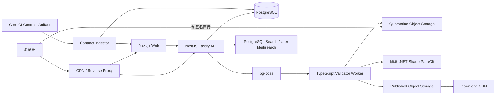

# DawnlightCore 网站 V2 详细实现方案

状态：推荐方案，待 V1 生产门禁关闭后启动

编写日期：2026-08-17

上位文档：[DawnlightCore 网站整体开发文档](./DawnlightCoreWebsiteDevelopmentPlan.md)

当前基线：[V1 当前进度与剩余项](./V1-Progress.md)

实现进度：V2-WP0～WP8 的工程实现已完成；V2-WP9-0 已冻结四项关键决策；V2-WP9-1 已实现可复现部署制品和 WP9-A Compose；V2-WP9-2 已实现第一层 takedown 闭环；V2-WP9-3 已实现第一层完整发布、普通撤回、队列积压、对象存储故障、可见性回滚、重试恢复和脱敏报告；V2-WP9-4 已实现由 Quality 门禁调用的 Web/API/Worker GHCR 发布、SBOM、provenance、OIDC attestation、漏洞报告和候选清单；V2-WP9-5 已把首次成功 CI 候选按 digest 部署到 WP9-A，完成 Critical 可达性分析、健康、回滚、普通撤回和故障恢复演练。可信 Validator、完整漏洞签字、实名责任清单和 WP9-B 真实 staging 仍是 Beta 门禁，详见 [WP9-5 候选 staging 证据](./V2-WP9-5-CandidateStagingEvidence.md)与 [第一次真实发布门禁](./V2-FirstRealRelease-Gate.md)。

适用范围：从静态 Preview 开发者门户演进为受控的开发工具、光影目录和邀请制发布平台

## 1. 结论与版本定位

V2 不建议直接实现“开放注册、任意上传、评论评分和完整 Modrinth 社区”。V1 当前最有价值的下一步是把已经存在的 Core contract 和下载体验变成可查询、可验证、可追溯的动态产品，同时用受控发布链路验证数据模型和安全边界。

V2 的目标是：

1. 让开发者可以在网站上查询诊断、Catalog、Capability 和 Pipeline 结构，而不必阅读 DawnlightCore 私有 C# 源码；
2. 让玩家可以浏览维护者确认的光影项目、版本和兼容 artifact，并得到可解释的下载推荐；
3. 让受邀作者可以完成草稿、上传、隔离验证、修改、审核和发布的闭环；
4. 为未来公开社区建立稳定 REST API、不可变 artifact、审计记录和可运营的审核基础。

V2 仍然是“受控社区 Beta”，不是最终的公开社区。评论、评分、关注、集合、排行榜和开放注册投稿不属于 V2 的默认交付内容。

## 2. 启动前置条件

V2 的动态功能必须建立在 V1 生产条件和 Core 合同条件之上。以下任一项未满足时，只能继续做不依赖生产数据的工具 UI 或本地 fixture，不能接入真实上传与公开下载：

| 前置条件 | 最低证据 | 阻塞的 V2 能力 |
| --- | --- | --- |
| 正式域名、部署 provider 和密钥归属 | WP0 决策记录与生产 smoke | 全部线上动态功能 |
| 至少一个真实、可访问、不可变的 Core release | 文件 size、SHA-256、签名和回滚记录 | 兼容性推荐、公开下载 |
| 稳定的 Core contract | Schema、Catalog、diagnostics、examples、CLI JSON 输出来自同一 commit | 工具页面和验证 Worker |
| 可安装的 `ShaderPackCli` 或等价 Loader runner | 版本、退出码、结构化诊断和容器镜像 | 上传验证、审核发布 |
| 内容政策、许可证规则和审核责任人 | 发布政策、SLA、升级联系人 | 邀请制作者发布 |
| 对象存储、CDN 和备份策略 | 独立 staging/production bucket 与恢复演练 | artifact 和图片上传 |

V1 的 Preview contract、空 release feed、概念 Hero 和 `.invalid` canonical 不得被 V2 文档或 fixture 伪装成生产能力。

## 3. V2 分层范围

V2 采用三个可独立验收的增量版本。每一层完成后都可以暂停，不要求一次性完成后续层。

### V2.0：开发工具与只读目录

必须交付：

- Diagnostic Explorer；
- Catalog Explorer；
- Capability Matrix；
- Pipeline Graph Viewer；
- Variant Explorer；
- Core contract 版本切换、差异和迁移入口；
- NestJS/Fastify API、PostgreSQL、只读项目/版本/artifact 模型；
- 维护者录入官方和确认项目；
- 社区目录、项目页、版本页、兼容性筛选和搜索；
- 根据用户选择推荐兼容 artifact；
- API OpenAPI 文档和生成的 TypeScript client。

明确不包含：账户、浏览器上传、第三方发布、评论和公开投稿。V2.0 的所有项目数据可以由版本化 seed 或维护者后台导入产生。

### V2.1：邀请制作者发布 Beta

在 V2.0 稳定运行后增加：

- OIDC 登录、邀请和项目团队；
- 项目草稿、版本草稿和发布向导；
- 预签名直传 quarantine bucket；
- 文件大小、hash、压缩包结构、图片和许可证预检；
- pg-boss 持久任务和独立 TypeScript Worker；
- 隔离容器中的真实 `.NET ShaderPackCli` Loader 验证；
- 自动验证报告、重试、超时和失败解释；
- 审核员队列、批准、拒绝、要求修改和完整审计；
- 发布后不可变 artifact、撤回和安全公告。

### V2.2：公开社区候选

只有 V2.1 连续运行并满足运营门槛后才评估：

- 受限开放注册和投稿配额；
- Meilisearch 或同等搜索服务和完整 facets；
- 收藏、关注、集合和作者通知；
- 更完整的下载和兼容性统计；
- 项目/版本安全公告和举报自助入口。

评论、评分、实时聊天和复杂社交图不是 V2.2 的前置条件，除非审核团队和滥用处理能力已经成熟。

## 4. 用户任务与验收结果

| 用户 | V2 核心任务 | 成功结果 |
| --- | --- | --- |
| 新作者 | 查询一个诊断码并理解修复方向 | 结果包含版本、来源、相关字段、示例和下一步；无私有 C# 类型泄漏 |
| 高级作者 | 查看某版本的 Catalog、Capability 和资源图 | 所有节点来自结构化 contract，可复制稳定 ID 和深链 URL |
| 玩家 | 按 Core、游戏版本、平台和 GPU 能力找光影 | 列表显示兼容原因、验证状态、artifact hash 和下载来源 |
| 受邀作者 | 上传一个版本并处理失败 | 不可信文件进入 quarantine；失败可定位；修正后能重新提交 |
| 审核员 | 处理发布请求 | 可同时查看自动验证、许可证、内容和历史决定；批准不会产生半成品 |
| 工具/启动器 | 调用公共 API 查询项目和版本 | OpenAPI 版本稳定，分页、错误码、缓存和弃用规则明确 |

## 5. 总体架构



### 5.1 服务职责

- `apps/web`：页面、Server Component、交互和 API client，不直接访问数据库或对象存储凭据；
- `apps/api`：认证、授权、项目、版本、上传、验证任务、审核、发布、下载选择和公共 REST API；
- `apps/worker`：消费持久任务，执行不可信输入预检、调用隔离 Validator、生成报告、迁移对象和刷新搜索；
- `packages/database`：Prisma schema、迁移、事务 helper 和数据库健康检查；
- `packages/api-client`：由 OpenAPI 生成的 DTO/client，禁止手工复制 API 类型；
- `contracts/`：版本化 Core contract 快照和 ingest lock；
- Object Storage：quarantine、published、derived-images 三个逻辑隔离区域；
- CDN：只服务已发布的不可变对象，API 不代理大文件。

V2 初期保持模块化单体，不拆微服务。Worker 与 API 可以独立部署，但共享版本化 package 和数据库迁移。

## 6. 技术实施决策

| 领域 | V2 推荐 | 边界 |
| --- | --- | --- |
| Web | 现有 Next.js App Router + TypeScript strict | 保留 V1 静态文档和下载页面；动态页面按需 SSR/缓存 |
| API | NestJS + Fastify + REST/OpenAPI | `/api/v1` 只发布已审核的 DTO，不暴露 Prisma model |
| 数据库 | PostgreSQL + Prisma | 事务数据、审核和 outbox；不保存二进制正文 |
| 队列 | pg-boss | 上传验证、索引、图片和统计任务；任务必须可重试、去重和超时 |
| 存储 | S3-compatible | 预签名上传、服务端 copy、不可变 published key |
| 认证 | OIDC provider | 先白名单邀请，账号合并和恢复策略在上线前冻结 |
| 搜索 | V2.0 PostgreSQL 查询；V2.2 再评估 Meilisearch | 文档 Orama 索引仍独立维护 |
| contract | Core CI 生成 JSON artifact | 网站展示 contract，不在 TS 重写 Loader |
| 验证 | 隔离容器中的 `.NET ShaderPackCli` | Worker 只编排和保存结果，不信任作者自报状态 |
| 观测 | Pino + OpenTelemetry + uptime checks | 日志脱敏，上传内容和 token 不进入日志 |

V2 不提前引入 GraphQL、Kubernetes、Redis、Elasticsearch 或实时 WebSocket。只有性能和运营数据证明需要时才新增基础设施。

## 7. 领域模型与状态机

### 7.1 核心实体

| 实体 | 关键字段 | 约束 |
| --- | --- | --- |
| `User` | id、oidcSubject、displayName、status | OIDC subject 唯一，禁用用户不能写入 |
| `Project` | id、slug、ownerId、visibility、license、status | slug 永久保留；删除采用撤回/隐藏 |
| `Membership` | projectId、userId、role | owner/maintainer/reviewer 分权；唯一复合键 |
| `ProjectVersion` | projectId、version、channel、status、changelog | 同项目版本不可覆盖；遵循 SemVer 或明确 preview 规则 |
| `Artifact` | versionId、platform、arch、size、sha256、signature、objectKey | hash、size、object key 不可变；发布后只读 |
| `Compatibility` | artifactId、coreRange、gameRange、graphicsApi、gpuCaps | 结构化范围，不用自由文本作为唯一判断 |
| `Upload` | projectId、objectKey、expectedSize、expiresAt、status | quarantine only；完成前不能进入验证队列 |
| `ValidationRun` | upload/versionId、toolVersion、coreCommit、status、diagnostics | 记录输入 hash、退出码、超时和环境 |
| `Review` | versionId、reviewerId、decision、reason、createdAt | 决定不可静默修改；新决定追加记录 |
| `AuditEvent` | actor、action、resource、requestId、metadata | append-only；敏感字段脱敏 |
| `DownloadEvent` | artifactId、timeBucket、edge、referrerClass | 聚合和最小化保存，不保存完整 IP |

### 7.2 发布状态

```text
draft -> uploaded -> validating -> validation_failed
                              \-> awaiting_review -> changes_requested
                                                   \-> approved -> published
published -> withdrawn
```

状态变更只能通过 API service 在事务中完成，并写入 outbox/audit。`published` 之后不允许替换 artifact、兼容性或签名；修复必须创建新版本。`withdrawn` 仍保留历史和 hash，但从默认推荐和下载入口移除。

### 7.3 验证状态

验证报告至少区分：`schema-only`、`loader-passed`、`loader-failed`、`security-failed`、`timed-out`、`infrastructure-error`。`schema-only` 永远不能满足发布条件。

## 8. API 合同

### 8.1 公共只读 API

```text
GET /api/v1/projects?query=&core=&game=&platform=&page=
GET /api/v1/projects/{slug}
GET /api/v1/projects/{slug}/versions
GET /api/v1/projects/{slug}/versions/{version}
GET /api/v1/artifacts/{artifactId}
GET /api/v1/compatibility/matrix
GET /api/v1/contracts/{coreVersion}
GET /api/v1/diagnostics/{code}
GET /api/v1/catalog/{catalogId}
GET /api/v1/search
```

公共接口必须有 cursor 或稳定 page token、默认上限、字段选择策略、ETag/Cache-Control 和 rate limit。下载接口只返回短时效跳转或 CDN URL，不返回对象存储密钥。

### 8.2 受保护写 API

```text
POST /api/v1/projects
POST /api/v1/projects/{slug}/invites
POST /api/v1/projects/{slug}/uploads
POST /api/v1/uploads/{uploadId}/complete
POST /api/v1/versions/{versionId}/submit
POST /api/v1/reviews/{versionId}/decision
POST /api/v1/versions/{versionId}/withdraw
POST /api/v1/reports
```

所有创建上传、完成上传、提交审核、审核决定和撤回请求要求 `Idempotency-Key`。统一错误 envelope 采用稳定 `code`、本地化 `message`、`requestId` 和可选 `details`；不返回栈、SQL、内部路径或签名 URL。

### 8.3 OpenAPI 门禁

每个 API 变更必须：

1. 更新 OpenAPI source；
2. 生成 `packages/api-client`；
3. 执行 breaking-change diff；
4. 运行 API contract tests 和 web fixture tests；
5. 记录弃用日期和替代字段。

## 9. 前端信息架构

保留 V1 的首页、文档和官方 Release 路由，新增功能使用明确的 `/tools` 和 `/shaders` 入口：

```text
/{locale}/tools/diagnostics
/{locale}/tools/diagnostics/{code}
/{locale}/tools/catalog
/{locale}/tools/capabilities
/{locale}/tools/pipeline
/{locale}/tools/variants
/{locale}/tools/contract-diff
/{locale}/shaders
/{locale}/shaders/{projectSlug}
/{locale}/shaders/{projectSlug}/versions/{version}
/{locale}/account/projects
/{locale}/account/projects/{projectSlug}/versions/new
/{locale}/account/uploads/{uploadId}
/{locale}/moderation/reviews
```

### 9.1 工具页面

- Diagnostic Explorer：按代码、状态、Core 版本和关键词筛选；展示原因、触发字段、修复建议、相关页面和示例；
- Catalog Explorer：按类型和版本浏览稳定 ID，显示 owner、输入输出、可用条件和弃用状态；
- Capability Matrix：Core、Manifest、游戏、Graphics API 和 GPU capability 分栏比较；
- Pipeline Graph：从结构化 graph dump 渲染节点和边，提供列表模式、失败节点定位和非空画布测试；
- Variant Explorer：显示 option/define 组合、排除原因和最终选择，不在浏览器自行推断 Loader 结果；
- Contract Diff：比较两个 Core/Manifest 合同，标记新增、变更、弃用和迁移建议。

### 9.2 目录页面

列表默认返回轻量卡片，不加载完整图库和 changelog。筛选条件必须进入 URL，支持分享和回退。项目页先展示兼容性、验证状态、最新版本和下载，再展示长文本。

### 9.3 作者和审核页面

作者上传流程采用步骤式页面：项目元数据 -> 文件直传 -> 预检 -> Loader 验证 -> 提交审核 -> 结果。每一步都可刷新恢复，不能依赖单页内存状态。审核页使用双栏：版本信息/文件和验证/许可证/历史决定；危险操作要求再次确认并写 reason。

## 10. 上传、验证与发布流水线

### 10.1 上传流程

1. API 校验身份、项目权限、配额、声明大小和允许扩展名；
2. 返回短时效、单对象、限制大小的预签名 URL；
3. 浏览器直传 quarantine；
4. `complete` 通过对象存储 HEAD 检查 size、content type 和对象存在性；
5. API 事务创建去重的 validation job；
6. Worker 下载到临时隔离目录，拒绝 zip slip、绝对路径、symlink、zip bomb、重复字段和超大嵌套 JSON；
7. 计算服务端 hash，扫描许可证和图片，生成预检报告；
8. 在无网络、只读、无生产凭据的容器中调用固定版本 Loader；
9. 保存退出码、诊断、Core commit、CLI 版本、输入 hash 和日志摘要；
10. 通过后把对象服务端 copy 到不可变 published key，失败或待审对象永远不能被公开 CDN 访问。

### 10.2 重试和故障

- schema/内容错误不自动重试；
- Worker 崩溃、网络短暂错误和对象存储 5xx 使用指数退避，设置最大次数；
- Loader 超时进入 `timed-out`，不得无限重试；
- 队列积压、容器不可用和存储故障进入告警；
- 任何发布动作使用事务锁和幂等键，避免重复 artifact、重复审核决定和重复统计。

## 11. 安全与隐私基线

V2 的最大新增风险是“不可信上传 + 身份写操作”，安全门禁必须先于 UI 完成：

- OIDC callback 使用 state、nonce、PKCE；cookie 为 HttpOnly、Secure、SameSite；
- 写 API 做资源级授权，前端隐藏按钮不算权限控制；
- 上传仅允许预签名直传，API 不接收大文件 body；
- quarantine 与 published bucket 使用不同凭据和生命周期；
- Worker 不拥有生产数据库写权限，使用受限结果通道；
- 容器无网络、非 root、只读根文件系统、CPU/内存/时间/文件数限制；
- 解压拒绝路径穿越、符号链接、设备文件、重复路径和压缩炸弹；
- JSON 限制大小、深度、键数和未知字段策略；
- Markdown、项目名、图片和日志均按不可信输入编码/清洗；
- 下载跳转、搜索、上传、登录和举报均限流；
- 审计日志 append-only，禁止记录 token、签名 URL、完整 IP 和包正文；
- 私人草稿、验证日志和审核备注默认不可公开；
- CSP 先 Report-Only，收集真实报告后再评估 enforced；
- 账号删除、项目撤回和版权投诉都有保留期与升级路径。

## 12. 数据、搜索和缓存策略

### 12.1 数据导入

Core CI 生成并签名 `contract-manifest.json`，包含 Core commit、contract version、各文件 hash 和生成工具版本。`Contract Ingestor` 校验签名和 schema 后写入版本表，失败不影响当前生产数据。

### 12.2 搜索

V2.0 以 PostgreSQL trigram/全文查询实现项目、诊断和 Catalog 搜索，文档继续使用 Orama。查询先支持 `q`、Core、游戏、平台、Graphics API、验证状态、license 和 channel；只有项目规模和 P95 延迟超过门槛时才迁移 Meilisearch。

### 12.3 缓存

- contract、诊断、Catalog 和已发布项目使用版本化 ETag 与长缓存；
- 列表使用短缓存和显式失效；
- 用户草稿、审核队列和验证状态不得进入公共 CDN 缓存；
- published artifact 采用 hash/key immutable cache；撤回通过 API/feed 状态阻止新推荐，而不是修改旧对象。

## 13. 质量门禁与测试矩阵

### 13.1 必须自动化

- API schema、OpenAPI diff、DTO 生成和数据库迁移检查；
- 项目/版本/成员/审核状态机单元测试；
- PostgreSQL、pg-boss、S3-compatible provider 集成测试；
- 上传 fixture：zip slip、zip bomb、symlink、Unicode path、超大 JSON、恶意图片；
- Validator mock 与真实 CLI container smoke；
- Web Playwright：工具查询、筛选 URL、项目详情、上传恢复、审核和下载推荐；
- axe：登录、作者、审核和错误状态；
- 限流、幂等、权限越权和 CSRF 测试；
- 公开 API 的分页、缓存、错误码和弃用合同测试。

### 13.2 必须人工验收

- 新作者从诊断到修复的完整路径；
- 玩家在不同 Core/平台/GPU 条件下能理解推荐理由；
- 审核员能在不读日志原文的情况下决定发布；
- 360/768/1280/1536 宽度、Light/Dark、键盘和 200% zoom；
- 真实 host 的 TLS、安全头、CDN、回源、上传和回滚；
- 一次真实 Validator 超时、对象存储故障和撤回演练。

### 13.3 推荐门槛

| 指标 | V2 Beta 门槛 |
| --- | ---: |
| API 5xx | < 0.5%（不含主动限流） |
| 公共 GET P95 | < 500 ms（不含 CDN 命中下载） |
| 验证任务成功完成率 | > 99%（排除作者内容失败） |
| 发布后 artifact hash 错误 | 0 |
| 权限越权或公开 quarantine 对象 | 0 |
| 未解释的审核决定 | 0 |
| 高危依赖/容器漏洞 | 0 个未接受风险 |

## 14. 工作包与实施步骤

以下工作包按依赖顺序执行；每个工作包完成后创建独立提交，并在对应退出条件满足前不进入下一包。

### V2-WP0：范围、合同和运营冻结

输入：V1 进度、Core release 计划、内容政策草案。

步骤：

1. 冻结 V2.0/V2.1/V2.2 的范围和不做清单；
2. 选定 OIDC provider、对象存储、CDN、邮件/通知和监控归属；
3. 冻结 Core contract、CLI JSON、artifact 签名、兼容性表达和版本策略；
4. 评审上传威胁模型、数据保留、版权投诉和审核 SLA；
5. 建立 V2 ADR、风险登记和 fixture 清单。

交付：V2 Decision Register、Threat Model、Contract Checklist、Beta 运营手册。

退出条件：没有未决的生产权限、签名、数据归属或审核责任问题。

### V2-WP1：动态工程骨架与环境隔离

步骤：

1. 在 pnpm workspace 增加 `apps/api`、`apps/worker`、`packages/database`、`packages/api-client`；
2. 建立 dev/staging/prod 环境变量 schema 和 secret names，禁止共享生产密钥；
3. 添加 Fastify health/readiness、Pino requestId、OpenTelemetry 基础 trace；
4. 用 Docker Compose 启动 PostgreSQL、pg-boss 依赖和 MinIO 测试存储；
5. 配置迁移、seed、测试数据库和 CI cache；
6. 保持 `apps/web` 的静态页面无 API 时仍可构建。

退出条件：空模块可在干净环境启动，迁移可重复执行，health/readiness 能区分依赖故障。

### V2-WP2：Contract ingest 与开发工具数据层

步骤：

1. 定义 `contract-manifest.json`、签名和 ingest lock；
2. 将 Schema、Catalog、diagnostics、capabilities、graph dump、variant explain 导入版本化表；
3. 定义稳定 ID、版本、状态、sourceRef 和 deprecation 字段；
4. 为 Diagnostic、Catalog、Capability、Graph、Variant 和 Contract Diff 建立只读 service；
5. 为每个查询生成 OpenAPI schema、缓存策略和 fixture；
6. 对不存在、已弃用和跨版本冲突 ID 返回可解释错误。

退出条件：同一 Core commit 的数据可从 API 和静态 fixture 得到一致结果，导入失败不会覆盖当前版本。

### V2-WP3：Developer Tools 前端

步骤：

1. 实现工具路由、版本切换、搜索、筛选、深链和空/错误状态；
2. 先实现 Diagnostic/Catalog/Capability，再实现 Graph/Variant 和 Diff；
3. Graph 使用 React Flow + ELK.js，提供列表降级和节点数量/非空画布测试；
4. 复制稳定 ID、JSON path、诊断码和迁移建议；
5. 为工具页增加文档上下文链接，避免工具和文档产生两套解释；
6. 补充响应式、键盘、主题和 200% zoom 验收。

退出条件：作者无需查看私有 C# 源码即可完成常见诊断、Catalog 和 variant 查询。

### V2-WP4：只读目录与兼容性推荐

步骤：

1. 建立 Project、ProjectVersion、Artifact、Compatibility、Image 和 License 数据模型；
2. 创建维护者 seed/import 命令，禁止前端直接修改数据库；
3. 实现项目列表、项目详情、版本详情、兼容矩阵和下载推荐；
4. 将筛选条件编码到 URL，支持 Core/game/platform/API/GPU/channel/license/status；
5. 以结构化规则解释推荐原因和排除原因；
6. 对 withdrawn、unverified、preview artifact 做显著状态区分；
7. 生成 SEO metadata、sitemap 变更和公共 API 缓存头。

退出条件：维护者可录入一个真实项目，玩家可按环境找到正确 artifact，且 API 不暴露 quarantine 或私有字段。

### V2-WP5：OIDC、项目团队与作者草稿

步骤：

1. 接入 OIDC Authorization Code + PKCE、state、nonce 和安全 cookie；
2. 实现邀请、接受、撤销、账号禁用和项目成员角色；
3. 将 Project/Version 写操作限制到资源级权限；
4. 实现草稿元数据、changelog、license、compatibility 和 artifact 预声明；
5. 增加审计事件和幂等键；
6. 编写账号恢复、删除和版权投诉对应的运营 SOP。

退出条件：受邀作者可创建和编辑自己的草稿，越权请求全部被拒绝并留下审计记录。

### V2-WP6：Quarantine 上传与预检 Worker

步骤：

1. API 创建 upload session，返回短时效单对象预签名 URL；
2. complete 只接受对象存储 HEAD 证据，不信任浏览器 hash/size；
3. Worker 下载到临时隔离目录，限制 CPU、内存、时间、文件数和总解压体积；
4. 检测路径穿越、symlink、zip bomb、重复路径、非法扩展名、超大 JSON 和恶意图片；
5. 计算服务端 SHA-256，保存输入清单和预检诊断；
6. 失败对象进入过期回收队列，不得被公开 URL 访问；
7. 对 job 使用去重键、重试上限、超时和死信处理。

退出条件：所有危险 fixture 被拒绝；正常包能生成可重复的预检报告；API 内存不会随包大小增长。

### V2-WP7：真实 Loader 验证与审核发布

步骤：

1. 构建固定版本、无网络、非 root、只读根文件系统的 Validator image；
2. Worker 以最小权限调用 `ShaderPackCli`，传入 Core commit、包路径和输出目录；
3. 将 schema、Loader、security、resource 和 compatibility 结果分开记录；
4. 为失败、超时、基础设施错误分别定义重试和用户提示；
5. 实现作者修订、重新验证和审核队列；
6. 审核批准时在事务中冻结 metadata、写 audit/outbox，并服务端 copy 到 published key；
7. 发布后生成签名 feed、CDN metadata 和撤回公告。

退出条件：受邀作者可发布一个经过真实 Loader 验证的版本；任何失败、待审或撤回版本都不会进入默认下载。

### V2-WP8：搜索、下载统计与运营控制台

步骤：

1. 为项目、版本、诊断和 Catalog 建立查询索引和 facet；
2. 下载事件仅记录时间桶、artifact、edge 和粗粒度来源；
3. 为热门项目、验证失败率、队列积压、下载错误和存储容量建立 dashboard；
4. 增加 reviewer queue、举报、撤回、公告和封禁操作；
5. 对下载、搜索、上传、登录和举报配置限流；
6. 设计数据保留、导出和删除任务，不把统计用于未经同意的个人画像。

退出条件：运营人员能发现异常、撤回 artifact、处理审核队列并在不访问原始包正文的情况下完成日常工作。

### V2-WP9：Beta 发布、演练与决策复盘

步骤：

1. 用 staging 的独立数据库、bucket、OIDC client 和 CDN 做完整演练；
2. 运行浏览器、API、Worker、真实 CLI、权限和安全 fixture 全套测试；
3. 进行对象存储故障、队列积压、Validator 超时、撤回和回滚演练；
4. 邀请少量维护者和作者完成任务观察，记录阻塞和误导文案；
5. 达到 Beta 门槛后只开放维护者录入和邀请制发布；
6. 运行至少一个稳定周期后，单独评审是否进入 V2.2 公开社区。

退出条件：所有 P0 安全问题关闭，发布/撤回/回滚证据齐全，真实参与者可以完成核心任务，且运营责任人签字。

## 15. 推荐实施顺序与提交策略

建议按以下顺序推进，每个工作包至少一个提交：

```text
V2-WP0 冻结
  -> V2-WP1 工程骨架
  -> V2-WP2 Contract ingest
  -> V2-WP3 Developer Tools
  -> V2-WP4 只读目录
  -> V2-WP5 身份与草稿
  -> V2-WP6 Quarantine 预检
  -> V2-WP7 Loader/审核/发布
  -> V2-WP8 搜索与运营
  -> V2-WP9 Beta 演练
```

每个提交必须：

- 只改变本工作包拥有的模块或明确相关合同；
- 包含迁移、fixture、测试或文档更新；
- 通过受影响范围的 lint、typecheck、unit/integration test；
- 在工作包完成时运行完整 `pnpm check` 和对应 staging smoke；
- 记录实际 Core commit、CLI image digest、artifact hash 和环境。

## 16. V2 DoD

V2.0 只有同时满足以下条件才算完成：

- 工具页面由同一版本化 Core contract 驱动，Graph/Variant 不依赖浏览器猜测；
- 只读目录有真实维护者录入项目，兼容性和下载推荐可解释；
- API v1 OpenAPI、错误码、分页、缓存和弃用策略已锁定；
- 数据库迁移、seed、备份和恢复已在 staging 验证；
- Web/API 的权限边界、缓存和公共/私有字段通过测试；
- V1 页面和静态 Preview 构建继续通过。

V2.1 只有同时满足以下条件才算 Beta 发布：

- 受邀作者能端到端上传、验证、修改、提交和发布；
- 真实 Loader 验证结果与 CLI 版本/Core commit 可追溯；
- quarantine、published、derived-images 权限和生命周期隔离；
- 审核决定、撤回、举报和版权流程可追溯；
- 危险上传 fixture、越权、限流、幂等和故障演练通过；
- 没有公开半成品、私有草稿或签名 URL 泄漏。

V2.2 是否启动由独立决策记录决定，不得把“V2.1 Beta 通过”自动解释为“开放社区已批准”。

## 17. 风险与取舍

| 风险 | 处理方式 |
| --- | --- |
| Core contract 仍变化 | 所有工具和项目兼容性绑定 contract version；保留旧版本只读数据，不原地覆盖 |
| CLI 尚不稳定 | V2.0 先使用 contract fixture；V2.1 前必须提供真实 JSON 输出和容器 digest |
| 上传安全复杂 | 先邀请制、配额和小文件限制；公开投稿延后 |
| 审核资源不足 | 使用维护者录入和邀请名单；不以自动验证替代人工审核 |
| 搜索规模不足 | V2.0 使用 PostgreSQL；测量后再迁移 Meilisearch |
| 对象存储 provider 变更 | 通过 S3 adapter 和不可变 object key 隔离 provider |
| 动态功能破坏静态门户 | Web 将动态路由和 V1 静态路由分开，API 不可用时静态文档仍可浏览 |
| 统计造成隐私风险 | 只保存最小化聚合事件，明确保留期和删除机制 |

## 18. V2 第一批具体任务

启动 V2 后，第一批实现可以按以下顺序落地：

1. 创建 `docs/V2-DecisionRegister.md` 和上传威胁模型；
2. 冻结 contract-manifest、CLI JSON、Artifact/Compatibility DTO；
3. 添加 API/Worker/database workspace skeleton 和 Compose；
4. 完成 contract ingest 的只读 API；
5. 先交付 Diagnostic Explorer，再交付 Catalog/Capability；
6. 用维护者 seed 建立一个项目、一个版本和多个兼容 artifact；
7. 实现项目列表、详情和推荐下载；
8. 用测试 OIDC provider 完成邀请和团队权限；
9. 用 MinIO fixture 完成 quarantine、预检和回收；
10. 最后才接入真实 CLI container、审核和 published bucket。

这十项完成前不应开放真实第三方上传，也不应在导航中承诺“社区投稿已开放”。
